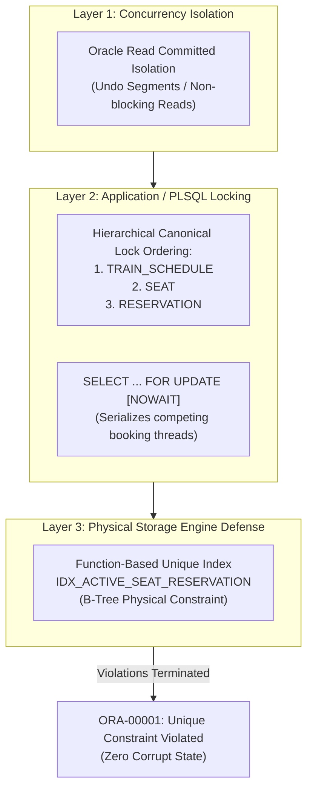
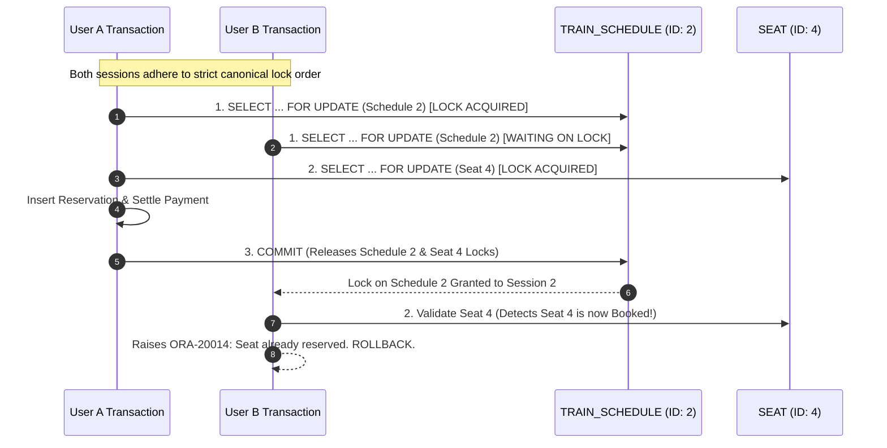

# Concurrency Control & Double-Booking Prevention

**Course Code:** BCSE302L — Database Management Systems  
**Project Title:** Terminus: High-Integrity Railway Reservation & Inventory Management System  
**Document Ref:** `docs/CONCURRENCY_CONTROL.md`  

---

## 1. Concurrency Challenges in Railway Reservation Systems

A computerized railway reservation system experiences high concurrent transaction volume. When high-demand holiday trains open for reservation, thousands of booking requests arrive simultaneously targeting a finite inventory of berths.

Without rigorous database-level concurrency control, systems succumb to severe concurrency anomalies:
1. **The Double-Booking Race Condition:** Two concurrent transactions read the identical seat as "AVAILABLE." Both proceed to insert reservations, resulting in two passengers assigned to a single physical seat.
2. **Phantom Reads & Lost Updates:** One transaction updates a seat's status while another transaction overwrites the same record using stale snapshot data.
3. **Cyclic Deadlocks (`ORA-00060`):** Competing sessions acquire resource locks in conflicting orders (e.g., Session 1 locks Schedule A then attempts to lock Seat B, while Session 2 locks Seat B then attempts to lock Schedule A), forcing the database kernel to terminate one session.

**Terminus** deploys a multi-layered concurrency architecture combining **Oracle Read Committed MVCC, Pessimistic Row Locking, Strict Lock Ordering, and a Sparse Function-Based Unique Index**.



---

## 2. Oracle Read Committed Isolation & Multi-Version Read Consistency (MVCC)

Oracle Database implements **Read Committed** isolation through Multi-Version Concurrency Control (MVCC):
- **Query Read Consistency:** A query sees only data committed before the query statement began execution. If a concurrent transaction modifies and commits data while a long-running query is executing, the query does not see those changes; it reads consistent before-images from Oracle **Undo Segments**.
- **Non-Blocking Reads:** Readers never wait for writers, and writers never wait for readers. Public passenger searches (`Q01`) can execute at maximum throughput without being blocked by active ticket bookings.

---

## 3. Pessimistic Row-Level Locking (`SELECT ... FOR UPDATE`)

To serialize state mutations where two transactions attempt to reserve the same inventory, Terminus employs **Pessimistic Locking**:
```sql
SELECT train_id, schedule_status
INTO v_train_id, v_schedule_status
FROM TRAIN_SCHEDULE
WHERE schedule_id = p_schedule_id
FOR UPDATE;
```
1. **Exclusive Lock Acquisition:** The first transaction to execute this statement acquires an exclusive row lock on the target schedule record in the Oracle data block.
2. **Queueing of Contenders:** Any concurrent transaction attempting to book a seat on the same schedule is forced to wait until the first transaction issues `COMMIT` or `ROLLBACK`.
3. **Fail-Fast with NOWAIT:** In administrative or high-concurrency contention scenarios, `FOR UPDATE NOWAIT` is used to raise exception `ORA-00054: resource busy and acquire with NOWAIT specified` immediately, allowing the application to gracefully inform the user rather than hanging.

---

## 4. Canonical Lock Ordering & Deadlock Prevention

According to Coffman's condition for deadlocks, a deadlock can only occur if four conditions are met: Mutual Exclusion, Hold and Wait, No Preemption, and **Circular Wait**.

Terminus eliminates circular wait by enforcing **Strict Canonical Lock Ordering** (Havender's Algorithm):
$$\text{TRAIN\_SCHEDULE} \longrightarrow \text{SEAT} \longrightarrow \text{RESERVATION}$$



Because all transactions request resource locks in the identical hierarchical sequence, cyclic dependency graphs cannot form, mathematically guaranteeing zero `ORA-00060` deadlocks.

---

## 5. Physical Storage Defense: Function-Based Unique Index (`IDX_ACTIVE_SEAT_RESERVATION`)

Even if application code contains bugs, concurrent threads bypass PL/SQL validations, or raw SQL inserts are executed directly via SQL*Plus, double-booking is physically impossible due to the database's **Function-Based Unique Index**:

```sql
CREATE UNIQUE INDEX IDX_ACTIVE_SEAT_RESERVATION ON RESERVATION (
    CASE WHEN booking_status IN ('PENDING', 'CONFIRMED') THEN schedule_id END,
    CASE WHEN booking_status IN ('PENDING', 'CONFIRMED') THEN seat_id END
);
```

### Mathematical & Physical Index Mechanics:
1. **Sparse Uniqueness Evaluation:**
   - When a reservation is inserted with `booking_status = 'PENDING'` or `'CONFIRMED'`, the index expression evaluates to:
     $$(\text{schedule\_id}, \; \text{seat\_id})$$
   - Oracle inserts this key into the unique B-Tree index. If an identical `(schedule_id, seat_id)` tuple already exists in the index, Oracle aborts the insert with:
     $$\text{ORA-00001: unique constraint (RAILWAY\_USER.IDX\_ACTIVE\_SEAT\_RESERVATION) violated}$$
2. **Instantaneous Recycling on Cancellation:**
   - When a ticket is cancelled (`booking_status = 'CANCELLED'`) or expired (`'EXPIRED'`), the index expression evaluates to:
     $$(\text{NULL}, \; \text{NULL})$$
   - In standard Oracle relational semantics, **composite index keys containing entirely NULL values are excluded from the B-Tree index structure**.
   - As a result, the previously occupied seat immediately disappears from the unique index, allowing a new passenger to book that seat on that schedule without requiring background index defragmentation or table cleanup.

---

## 6. Concurrency Scenarios & Empirical Test Outcomes

The script `database/13_concurrency_tests.sql` executes four real-world concurrency scenarios to empirically verify locking behavior:

| Scenario ID | Test Scenario | Operational Steps | Mechanism Evaluated | Expected Outcome | Actual Verification Status |
| :---: | :--- | :--- | :--- | :--- | :---: |
| **CS-01** | **Simultaneous Double-Booking Attempt** | User A and User B concurrently execute `P_BOOK_TICKET` targeting Seat 4 on Schedule 2. | Procedural seat check + `SELECT FOR UPDATE` | User A succeeds; User B is rejected with error `ORA-20014: Seat already reserved`. | **PASS** |
| **CS-02** | **Direct Raw SQL Bypass Defense** | Two raw un-sanitized SQL `INSERT` statements targeting Seat 5 on Schedule 2 are executed back-to-back. | `IDX_ACTIVE_SEAT_RESERVATION` | First insert succeeds; second insert is blocked by Oracle engine with `ORA-00001`. | **PASS** |
| **CS-03** | **Parallel Non-Conflicting Bookings** | User A books Seat 5 (3A) while User B books Seat 6 (3A) on the same schedule in parallel. | Fine-grained row locking | Both bookings succeed simultaneously without blocking or false contention. | **PASS** |
| **CS-04** | **Cancellation & Immediate Re-Booking** | User A books Seat 1, confirms, then cancels. User B immediately attempts to book Seat 1 on the same schedule. | Sparse index nullification | User B's booking succeeds immediately. Proves cancelled seats are recyclable. | **PASS** |
