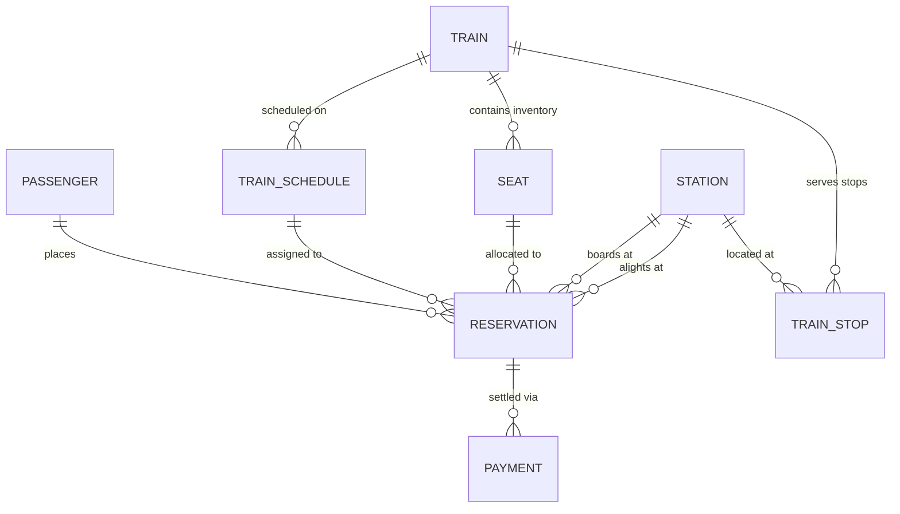

# Relational Database Design Rationale

**Course Code:** BCSE302L — Database Management Systems  
**Project Title:** Terminus: High-Integrity Railway Reservation & Inventory Management System  
**Document Ref:** `docs/DATABASE_DESIGN.md`  

---

## 1. Database Architecture & Design Rationale

The database schema of **Terminus** is constructed upon an **8-table normalized relational architecture** implemented on **Oracle Database 19c Enterprise Edition**. The primary design objective is to model the complex operational reality of a passenger railway network while strictly adhering to mathematical integrity constraints, relational normal forms, and transaction ACID guarantees.



---

## 2. Comprehensive Entity Rationales & Column Catalogs

---

### 2.1 Table: `PASSENGER`
- **Design Rationale:** Represents the legal passenger entity. Encapsulates identity and contact coordinates. Phone number and email address serve as distinct alternate keys with unique constraints to prevent duplicate identity spoofing and facilitate user authentication.
- **Primary Key:** `passenger_id` (Surrogate integer generated via `SEQ_PASSENGER_ID`).
- **Alternate / Candidate Keys:** `phone`, `email`.

| Column Name | Oracle Data Type | Nullable | Default | Constraints | Business Description & Semantic Meaning |
| :--- | :--- | :---: | :---: | :--- | :--- |
| `passenger_id` | `NUMBER` | No | — | `pk_passenger` (PK) | Surrogate identifier for passenger profile. |
| `full_name` | `VARCHAR2(100)` | No | — | — | Full legal name of passenger. |
| `date_of_birth` | `DATE` | No | — | — | Date of birth for age and concession evaluation. |
| `gender` | `VARCHAR2(10)` | No | — | `chk_passenger_gender` | Gender classification: `'Male'`, `'Female'`, or `'Other'`. |
| `phone` | `VARCHAR2(15)` | No | — | `uq_passenger_phone` | Unique mobile phone number with international dial code. |
| `email` | `VARCHAR2(100)` | No | — | `uq_passenger_email` | Unique primary email contact address. |

---

### 2.2 Table: `STATION`
- **Design Rationale:** Represents physical railway stations and junction points across national rail lines. While stations possess common names and cities, the official railway code (`station_code`, e.g., `NDLS`, `BCT`) is universally recognized across timetables and ticketing networks, enforced as a candidate key.
- **Primary Key:** `station_id` (Surrogate integer generated via `SEQ_STATION_ID`).
- **Alternate / Candidate Keys:** `station_code`.

| Column Name | Oracle Data Type | Nullable | Default | Constraints | Business Description & Semantic Meaning |
| :--- | :--- | :---: | :---: | :--- | :--- |
| `station_id` | `NUMBER` | No | — | `pk_station` (PK) | Surrogate identifier for railway station entity. |
| `station_code` | `VARCHAR2(10)` | No | — | `uq_station_code` | Official alphanumeric station code (e.g., `NDLS`, `BCT`). |
| `station_name` | `VARCHAR2(100)` | No | — | — | Standard full title of railway station. |
| `city` | `VARCHAR2(50)` | No | — | — | Municipal city location of station. |
| `state` | `VARCHAR2(50)` | No | — | — | State or territorial jurisdiction of station. |

---

### 2.3 Table: `TRAIN`
- **Design Rationale:** Represents the master catalog of rolling stock train services operating within the network. Each train service is identified by a unique official 5-digit train number (e.g., `12951`, `12001`). Services are classified into performance categories, and an operational lifecycle flag allows decommissioning without deleting historical booking references.
- **Primary Key:** `train_id` (Surrogate integer generated via `SEQ_TRAIN_ID`).
- **Alternate / Candidate Keys:** `train_number`.

| Column Name | Oracle Data Type | Nullable | Default | Constraints | Business Description & Semantic Meaning |
| :--- | :--- | :---: | :---: | :--- | :--- |
| `train_id` | `NUMBER` | No | — | `pk_train` (PK) | Surrogate identifier for train service. |
| `train_number` | `VARCHAR2(10)` | No | — | `uq_train_number` | Official 5-digit IR train identification code. |
| `train_name` | `VARCHAR2(100)` | No | — | — | Operational commercial name of train service. |
| `train_type` | `VARCHAR2(30)` | No | — | `chk_train_type` | Service classification: `Express`, `Superfast`, `Rajdhani`, etc. |
| `active_status` | `VARCHAR2(10)` | No | `'ACTIVE'` | `chk_train_status` | Operational status: `'ACTIVE'` or `'INACTIVE'`. |

---

### 2.4 Table: `TRAIN_STOP`
- **Design Rationale:** Models the directed graph of intermediate stopping stations for each train service. Establishes a 1-based sequential stop ordering (`stop_sequence`) and cumulative track distance from the origin station in kilometers (`distance_from_origin_km`), enabling accurate route validation and fare computation.
- **Primary Key:** Composite `(train_id, stop_sequence)`.
- **Foreign Keys:** `train_id` references `TRAIN(train_id)` with `ON DELETE CASCADE`; `station_id` references `STATION(station_id)`.
- **Alternate Keys:** `(train_id, station_id)` (A train cannot stop at the same physical station twice on a single service route).

| Column Name | Oracle Data Type | Nullable | Default | Constraints | Business Description & Semantic Meaning |
| :--- | :--- | :---: | :---: | :--- | :--- |
| `train_id` | `NUMBER` | No | — | `pk_train_stop`, `fk_stop_train` | Foreign key referencing parent `TRAIN`. |
| `stop_sequence` | `NUMBER` | No | — | `pk_train_stop` | 1-based sequential stop order along the route. |
| `station_id` | `NUMBER` | No | — | `fk_stop_station`, `uq_train_stop_station` | Foreign key referencing physical `STATION`. |
| `arrival_time` | `VARCHAR2(5)` | Yes | — | — | Scheduled 24-hr arrival time (`HH24:MI`); NULL at origin. |
| `departure_time` | `VARCHAR2(5)` | Yes | — | — | Scheduled 24-hr departure time (`HH24:MI`); NULL at terminus. |
| `distance_from_origin_km` | `NUMBER` | No | — | `chk_stop_dist` | Cumulative rail track distance from origin in kilometers ($\ge 0$). |

---

### 2.5 Table: `TRAIN_SCHEDULE`
- **Design Rationale:** Represents discrete calendar run instances of train services. Decouples static train route definitions from temporal journey dates. Guarantees that a train service operates at most once per calendar date via a composite unique constraint.
- **Primary Key:** `schedule_id` (Surrogate integer generated via `SEQ_SCHEDULE_ID`).
- **Foreign Keys:** `train_id` references `TRAIN(train_id)` with `ON DELETE CASCADE`.
- **Alternate Keys:** `(train_id, journey_date)`.

| Column Name | Oracle Data Type | Nullable | Default | Constraints | Business Description & Semantic Meaning |
| :--- | :--- | :---: | :---: | :--- | :--- |
| `schedule_id` | `NUMBER` | No | — | `pk_train_schedule` (PK) | Surrogate identifier for calendar trip schedule. |
| `train_id` | `NUMBER` | No | — | `fk_sched_train`, `uq_train_schedule` | Foreign key referencing parent `TRAIN`. |
| `journey_date` | `DATE` | No | — | `uq_train_schedule` | Calendar date of origin departure. |
| `scheduled_departure` | `TIMESTAMP` | No | — | — | Exact scheduled departure timestamp from origin station. |
| `scheduled_arrival` | `TIMESTAMP` | No | — | — | Exact scheduled arrival timestamp at final terminus. |
| `schedule_status` | `VARCHAR2(20)` | No | `'SCHEDULED'` | `chk_sched_status` | Operational status: `'SCHEDULED'`, `'RUNNING'`, `'COMPLETED'`, `'CANCELLED'`. |

---

### 2.6 Table: `SEAT`
- **Design Rationale:** Models the physical seating inventory and rake configuration for every train. Encapsulates coach numbers, seat numbers, travel classes, and berth orientations. A composite unique key prevents duplicate seat number assignments within the same coach rake.
- **Primary Key:** `seat_id` (Surrogate integer generated via `SEQ_SEAT_ID`).
- **Foreign Keys:** `train_id` references `TRAIN(train_id)` with `ON DELETE CASCADE`.
- **Alternate Keys:** `(train_id, coach_number, seat_number)`.

| Column Name | Oracle Data Type | Nullable | Default | Constraints | Business Description & Semantic Meaning |
| :--- | :--- | :---: | :---: | :--- | :--- |
| `seat_id` | `NUMBER` | No | — | `pk_seat` (PK) | Surrogate identifier for physical seat unit. |
| `train_id` | `NUMBER` | No | — | `fk_seat_train`, `uq_train_coach_seat` | Foreign key referencing parent `TRAIN`. |
| `coach_number` | `VARCHAR2(10)` | No | — | `uq_train_coach_seat` | Coach identifier code (e.g., `S1`, `B1`, `A1`, `H1`). |
| `seat_number` | `NUMBER` | No | — | `uq_train_coach_seat` | Integer sequence number of seat within coach. |
| `coach_class` | `VARCHAR2(10)` | No | — | `chk_seat_class` | Travel class: `SL`, `3A`, `2A`, `1A`, `CC`, `2S`, `EC`. |
| `berth_type` | `VARCHAR2(10)` | Yes | — | `chk_seat_berth` | Berth layout: `LOWER`, `MIDDLE`, `UPPER`, `SIDE_LOWER`, etc. |

---

### 2.7 Table: `RESERVATION`
- **Design Rationale:** The central operational entity recording individual passenger bookings across scheduled train runs. Tracks allocated seats, boarding and deboarding stations, booking timestamps, lifecycle statuses (`PENDING`, `CONFIRMED`, `CANCELLED`, `EXPIRED`), and total calculated fare.
- **Primary Key:** `reservation_id` (Surrogate integer generated via `SEQ_RESERVATION_ID`).
- **Foreign Keys:** `passenger_id`, `schedule_id`, `seat_id` (nullable), `source_station_id`, `destination_station_id`.
- **Alternate Keys:** `pnr` (Unique 10-12 character Passenger Name Record string generated via `SEQ_PNR`).
- **Special Index:** Composite Function-Based Unique Index `IDX_ACTIVE_SEAT_RESERVATION` on `(schedule_id, seat_id)` exclusively for `PENDING` and `CONFIRMED` states.

| Column Name | Oracle Data Type | Nullable | Default | Constraints | Business Description & Semantic Meaning |
| :--- | :--- | :---: | :---: | :--- | :--- |
| `reservation_id` | `NUMBER` | No | — | `pk_reservation` (PK) | Surrogate identifier for reservation. |
| `pnr` | `VARCHAR2(15)` | No | — | `uq_reservation_pnr` | Unique Passenger Name Record identifier code. |
| `passenger_id` | `NUMBER` | No | — | `fk_res_passenger` | Foreign key referencing `PASSENGER`. |
| `schedule_id` | `NUMBER` | No | — | `fk_res_schedule` | Foreign key referencing `TRAIN_SCHEDULE`. |
| `seat_id` | `NUMBER` | Yes | — | `fk_res_seat` | Foreign key referencing allocated `SEAT` (nullable). |
| `source_station_id` | `NUMBER` | No | — | `fk_res_src`, `chk_res_src_dest` | Foreign key referencing boarding `STATION`. |
| `destination_station_id`| `NUMBER` | No | — | `fk_res_dest`, `chk_res_src_dest`| Foreign key referencing deboarding `STATION`. |
| `booking_timestamp` | `TIMESTAMP` | No | `SYSTIMESTAMP` | — | Exact system timestamp when booking was initiated. |
| `booking_status` | `VARCHAR2(20)` | No | `'PENDING'` | `chk_res_status` | Status: `'PENDING'`, `'CONFIRMED'`, `'CANCELLED'`, `'EXPIRED'`. |
| `fare_amount` | `NUMBER(10,2)` | Yes | — | `chk_res_fare` | Total computed ticket fare in INR ($\ge 0$). |

---

### 2.8 Table: `PAYMENT`
- **Design Rationale:** The financial settlement and audit ledger for reservations. Encapsulates transaction amounts, settlement channels (`UPI`, `CARD`, `NET_BANKING`, `CASH`, `REFUND`), gateway processing statuses (`SUCCESS`, `FAILED`, `REFUND_SUCCESS`), unique transaction references (`TXN...`), and precise timestamps.
- **Primary Key:** `payment_id` (Surrogate integer generated via `SEQ_PAYMENT_ID`).
- **Foreign Keys:** `reservation_id` references `RESERVATION(reservation_id)`.
- **Alternate Keys:** `transaction_reference` (Unique bank gateway reference).

| Column Name | Oracle Data Type | Nullable | Default | Constraints | Business Description & Semantic Meaning |
| :--- | :--- | :---: | :---: | :--- | :--- |
| `payment_id` | `NUMBER` | No | — | `pk_payment` (PK) | Surrogate identifier for payment transaction. |
| `reservation_id` | `NUMBER` | No | — | `fk_pay_reservation` | Foreign key referencing parent `RESERVATION`. |
| `amount` | `NUMBER(10,2)` | No | — | `chk_pay_amount` | Monetary transaction amount in INR ($\ge 0$). |
| `payment_method` | `VARCHAR2(20)` | No | — | `chk_pay_method` | Channel: `'UPI'`, `'CARD'`, `'NET_BANKING'`, `'CASH'`, `'REFUND'`. |
| `payment_status` | `VARCHAR2(20)` | No | — | `chk_pay_status` | Processing status: `'SUCCESS'`, `'FAILED'`, `'REFUND_SUCCESS'`. |
| `transaction_reference`| `VARCHAR2(50)` | No | — | `uq_pay_txn_ref` | Unique gateway or bank reference token. |
| `payment_timestamp` | `TIMESTAMP` | No | `SYSTIMESTAMP` | — | Exact system registration timestamp of transaction. |

---

## 3. Key Design Decisions & Architectural Trade-offs

### 3.1 The 8-Table Scope Constraint & the SEAT Table Normalization Trade-off
In an ideal theoretical normalization to Boyce-Codd Normal Form (BCNF), the `SEAT` entity would be decomposed into two separate tables:
1. `COACH(train_id, coach_number, coach_class)`
2. `SEAT(coach_id, seat_number, berth_type)`

This decomposition is warranted because within a given train rake, all seats inside coach `B1` belong to class `3A`, implying the functional dependency:
$$\text{coach\_number} \longrightarrow \text{coach\_class}$$
Because $\text{coach\_number}$ is not a candidate key for `SEAT` (the candidate key is the composite tuple `(train_id, coach_number, seat_number)`), `SEAT` violates BCNF and resides strictly in **Third Normal Form (3NF)**.

**Deliberate Academic Trade-off:**  
The project specifications impose a strict boundary of **exactly 8 relational tables**. Introducing an auxiliary `COACH` table would increase the schema to 9 tables, exceeding the defined academic scope. Retaining `coach_class` within `SEAT` is an accepted engineering trade-off that preserves relational simplicity and reduces join depth while maintaining 3NF compliance.

### 3.2 Surrogate Keys vs. Natural Keys
While entities like `PASSENGER` have natural candidate keys (`phone`, `email`) and `TRAIN` has `train_number`, surrogate primary keys (`NUMBER` generated by Oracle sequences) were chosen for all primary keys:
- **Index Efficiency:** Fixed-width 64-bit integer keys minimize B-Tree index node footprint and maximize CPU cache line density compared to variable-width character strings.
- **Cascade Immunity:** If a passenger updates their mobile phone number or email address, zero foreign keys in `RESERVATION` need cascading updates.

### 3.3 Function-Based Sparse Indexing vs. Application-Level Locking
Preventing double-booking could theoretically be managed entirely in application code (e.g., synchronized Java blocks). However:
- Application-level locks fail completely in clustered or multi-instance deployments.
- The function-based unique index:
  ```sql
  CREATE UNIQUE INDEX IDX_ACTIVE_SEAT_RESERVATION ON RESERVATION (
      CASE WHEN booking_status IN ('PENDING', 'CONFIRMED') THEN schedule_id END,
      CASE WHEN booking_status IN ('PENDING', 'CONFIRMED') THEN seat_id END
  );
  ```
  delegates physical concurrency defense to the Oracle B-Tree storage engine. Furthermore, because cancelled or expired reservations evaluate to `(NULL, NULL)`, Oracle automatically excludes them from composite index uniqueness checks, allowing instantaneous re-booking without table purging.
