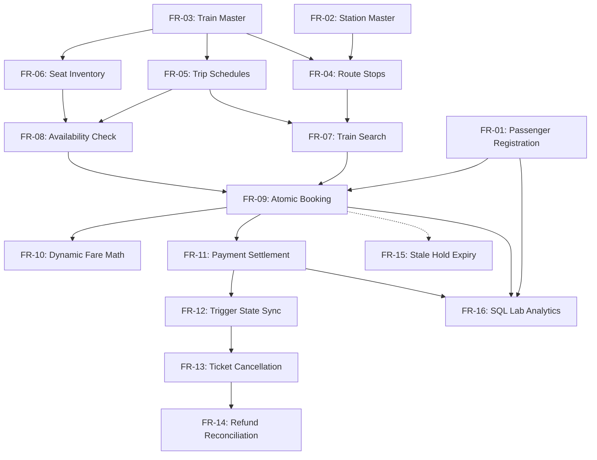

# Functional Requirements Specification

**Course Code:** BCSE302L — Database Management Systems  
**Project Title:** Terminus: High-Integrity Railway Reservation & Inventory Management System  
**Document Ref:** `docs/FUNCTIONAL_REQUIREMENTS.md`  

---

## 1. Overview & Classification Schema

This document details the functional requirements (FR-01 through FR-16) governing the **Terminus Railway Reservation System**. Each requirement is classified by its operational scope, business priority, relational entities involved, and database-level SQL/PLSQL mechanisms.

### Priority Classifications
- **CRITICAL:** Mandatory database-level integrity, transactional, or concurrency requirement. Failure violates ACID properties or corrupts inventory.
- **HIGH:** Essential business capability supporting passenger bookings, station routing, or administrative fleet management.
- **MEDIUM:** Analytical reporting, diagnostic tooling, or audit reconciliation capabilities.

---

## 2. Detailed Functional Requirements Matrix

---

### FR-01: Passenger Profile Registration and Profile Management
- **Requirement ID:** `FR-01`
- **Priority:** HIGH
- **Description:** The system must record and maintain passenger demographic and contact profiles. Phone number and primary email address must be globally unique across all profiles. Gender must be constrained to valid categories.
- **Tables Involved:** `PASSENGER`
- **SQL / PL/SQL Components:**
  - Constraints: `pk_passenger`, `uq_passenger_phone`, `uq_passenger_email`, `chk_passenger_gender`
  - Sequence: `SEQ_PASSENGER_ID`
  - DAO: `PassengerRepository.save()`, `PassengerRepository.findById()`
- **Acceptance Criteria:** Attempting to insert a duplicate phone number or email results in `ORA-00001`. Invalid gender values are rejected by check constraint `ORA-02290`.

---

### FR-02: Railway Station Catalog and Geographic Mapping
- **Requirement ID:** `FR-02`
- **Priority:** HIGH
- **Description:** The system must maintain a registry of railway stations and junction points, each identified by a surrogate station ID and an official unique railway alphanumeric station code (e.g., `NDLS`, `BCT`, `MAS`, `LKO`).
- **Tables Involved:** `STATION`
- **SQL / PL/SQL Components:**
  - Constraints: `pk_station`, `uq_station_code`
  - Index: `IDX_STATION_CODE`
  - Sequence: `SEQ_STATION_ID`
  - DAO: `StationRepository.findAll()`, `StationRepository.findByCode()`
- **Acceptance Criteria:** Duplicate station codes are blocked at database insertion. Station codes are standardized in uppercase strings.

---

### FR-03: Train Master Catalog and Service Classification
- **Requirement ID:** `FR-03`
- **Priority:** HIGH
- **Description:** The system must maintain the master catalog of train services, specifying unique 5-digit train numbers, official names, service classifications (`Express`, `Superfast`, `Rajdhani`, `Shatabdi`, `Duronto`, `Local`, `Mail`), and active operational status.
- **Tables Involved:** `TRAIN`
- **SQL / PL/SQL Components:**
  - Constraints: `pk_train`, `uq_train_number`, `chk_train_type`, `chk_train_status`
  - Index: `IDX_TRAIN_NUMBER`
  - Sequence: `SEQ_TRAIN_ID`
  - DAO: `TrainRepository.save()`, `TrainRepository.update()`
- **Acceptance Criteria:** Inserting invalid train types triggers `ORA-02290`. Setting `active_status = 'INACTIVE'` prevents the train from appearing in public search results.

---

### FR-04: Route Itinerary Definition and Stop Sequence Validation
- **Requirement ID:** `FR-04`
- **Priority:** CRITICAL
- **Description:** The system must model ordered route itineraries for each train. Each stop record must establish a 1-based stop sequence index, referencing the station, scheduled arrival time, scheduled departure time, and cumulative track distance from the origin in kilometers.
- **Tables Involved:** `TRAIN_STOP`, `TRAIN`, `STATION`
- **SQL / PL/SQL Components:**
  - Constraints: `pk_train_stop` (composite PK: `train_id`, `stop_sequence`), `uq_train_stop_station`, `fk_stop_train` (`ON DELETE CASCADE`), `fk_stop_station`, `chk_stop_dist`
  - Index: `IDX_TRAIN_STOP_STATION`
  - Trigger: `TRG_VALIDATE_RESERVATION` (verifies $Seq_{src} < Seq_{dest}$)
- **Acceptance Criteria:** Distance from origin must be non-negative. A train cannot visit the same physical station more than once per route.

---

### FR-05: Train Calendar Schedule Generation and Status Management
- **Requirement ID:** `FR-05`
- **Priority:** HIGH
- **Description:** The system must generate calendar-specific departures for scheduled trains, defining departure timestamps, expected arrival timestamps, and operational states (`SCHEDULED`, `RUNNING`, `COMPLETED`, `CANCELLED`).
- **Tables Involved:** `TRAIN_SCHEDULE`, `TRAIN`
- **SQL / PL/SQL Components:**
  - Constraints: `pk_train_schedule`, `fk_sched_train` (`ON DELETE CASCADE`), `uq_train_schedule` (composite: `train_id`, `journey_date`), `chk_sched_status`
  - Index: `IDX_SCHEDULE_TRAIN_DATE`
  - Sequence: `SEQ_SCHEDULE_ID`
  - DAO: `ScheduleRepository.findByDateRange()`
- **Acceptance Criteria:** A train can have only one scheduled departure per calendar date (`uq_train_schedule`).

---

### FR-06: Coach Layout and Physical Seat Inventory Configuration
- **Requirement ID:** `FR-06`
- **Priority:** CRITICAL
- **Description:** The system must model the physical seating layout for every train rake. Each seat must record its coach label (e.g., `S1`, `B1`, `A1`), seat sequence number, travel class (`1A`, `2A`, `3A`, `SL`, `CC`, `2S`, `EC`), and berth orientation (`LOWER`, `MIDDLE`, `UPPER`, `SIDE_LOWER`, `SIDE_UPPER`, `WINDOW`, `AISLE`, `NA`).
- **Tables Involved:** `SEAT`, `TRAIN`
- **SQL / PL/SQL Components:**
  - Constraints: `pk_seat`, `fk_seat_train` (`ON DELETE CASCADE`), `uq_train_coach_seat` (composite: `train_id`, `coach_number`, `seat_number`), `chk_seat_class`, `chk_seat_berth`
  - Index: `IDX_SEAT_TRAIN`
  - Sequence: `SEQ_SEAT_ID`
- **Acceptance Criteria:** No two seats on the same train can share the identical coach and seat number. Deleting a train cascades and deletes all associated physical seat inventory.

---

### FR-07: Station-to-Station Train Search Engine
- **Requirement ID:** `FR-07`
- **Priority:** HIGH
- **Description:** The system must allow users to query active trains running between a specified source station code and destination station code on or after a travel date, ensuring that boarding stop sequence precedes deboarding stop sequence.
- **Tables Involved:** `TRAIN`, `TRAIN_SCHEDULE`, `TRAIN_STOP` (source & dest), `STATION` (source & dest)
- **SQL / PL/SQL Components:**
  - Query: `SQL Query Q01`
  - PL/SQL Function: `F_AVAILABLE_SEAT_COUNT(schedule_id)`
  - Index: `IDX_TRAIN_STOP_STATION`, `IDX_SCHEDULE_TRAIN_DATE`
- **Acceptance Criteria:** Reverse routes (where origin stop sequence $\ge$ destination stop sequence) are excluded from search results. Available seats count reflects real-time unbooked capacity.

---

### FR-08: Dynamic Travel Class Seat Availability Inquiry
- **Requirement ID:** `FR-08`
- **Priority:** HIGH
- **Description:** The system must compute real-time seat availability breakdown per travel class (`1A`, `2A`, `3A`, `SL`, `CC`, etc.) for any given train schedule, deducting seats committed to active reservations.
- **Tables Involved:** `SEAT`, `TRAIN_SCHEDULE`, `RESERVATION`
- **SQL / PL/SQL Components:**
  - PL/SQL Function: `F_AVAILABLE_SEAT_COUNT(p_schedule_id, p_coach_class)`
  - Query: `SQL Query Q02`
  - DAO: `SeatRepository.findAvailableSeats()`, `SeatRepository.findByScheduleWithAvailability()`
- **Acceptance Criteria:** Returns accurate count of vacant seats. Seats in `PENDING` or `CONFIRMED` status are excluded from available count; seats in `CANCELLED` or `EXPIRED` status are included.

---

### FR-09: Pessimistic Atomic Ticket Booking Workflow
- **Requirement ID:** `FR-09`
- **Priority:** CRITICAL
- **Description:** The system must atomically execute ticket booking: acquiring a row-level lock on the train schedule, verifying seat ownership, validating route sequence direction, computing the fare, generating a unique PNR, inserting a `PENDING` reservation, and initiating payment.
- **Tables Involved:** `RESERVATION`, `TRAIN_SCHEDULE`, `SEAT`, `TRAIN_STOP`, `PASSENGER`
- **SQL / PL/SQL Components:**
  - Stored Procedure: `P_BOOK_TICKET`
  - Function-Based Index: `IDX_ACTIVE_SEAT_RESERVATION`
  - Sequence: `SEQ_RESERVATION_ID`, `SEQ_PNR`
  - Locking: `SELECT ... FOR UPDATE` on `TRAIN_SCHEDULE`
- **Acceptance Criteria:** Concurrent attempts to book the identical seat on the identical schedule are blocked. Transaction is kept open for application commit or rollback.

---

### FR-10: Deterministic Distance and Class Fare Computation
- **Requirement ID:** `FR-10`
- **Priority:** HIGH
- **Description:** The system must compute ticket fare deterministically based on rail distance between boarding and deboarding stations multiplied by class-specific rate multipliers, enforcing a mandatory minimum base fare of ₹50.00.
- **Tables Involved:** `TRAIN_STOP`, `TRAIN_SCHEDULE`, `SEAT`
- **SQL / PL/SQL Components:**
  - PL/SQL Function: `F_CALCULATE_FARE(p_schedule_id, p_source_station_id, p_dest_station_id, p_seat_id)`
  - Rates: `SL`=0.50, `3A`=1.20, `2A`=1.80, `1A`=3.00, `CC`=1.50, `2S`=0.30, `EC`=2.50
- **Acceptance Criteria:** Throws `ORA-20015` if destination stop distance is less than or equal to source stop distance. Returns round figures to 2 decimal places.

---

### FR-11: Multi-Channel Simulated Payment Processing
- **Requirement ID:** `FR-11`
- **Priority:** CRITICAL
- **Description:** The system must record payment transactions for bookings across settlement channels (`UPI`, `CARD`, `NET_BANKING`, `CASH`, `REFUND`), generating unique transaction references (`TXN...`) and validating reservation status prerequisites.
- **Tables Involved:** `PAYMENT`, `RESERVATION`
- **SQL / PL/SQL Components:**
  - Stored Procedure: `P_RECORD_PAYMENT`
  - Constraints: `pk_payment`, `fk_pay_reservation`, `uq_pay_txn_ref`, `chk_pay_amount`, `chk_pay_method`, `chk_pay_status`
  - Sequence: `SEQ_PAYMENT_ID`, `SEQ_TXN_REF`
- **Acceptance Criteria:** `SUCCESS` or `FAILED` payments require `RESERVATION.booking_status = 'PENDING'`. `REFUND_SUCCESS` requires `booking_status = 'CANCELLED'`.

---

### FR-12: Automated Payment-to-Reservation State Synchronization
- **Requirement ID:** `FR-12`
- **Priority:** CRITICAL
- **Description:** The system must automatically transition a reservation's status from `PENDING` to `CONFIRMED` upon successful recording of a payment record without requiring manual multi-step updates.
- **Tables Involved:** `PAYMENT`, `RESERVATION`
- **SQL / PL/SQL Components:**
  - Database Trigger: `TRG_SYNC_RESERVATION_ON_PAYMENT` (AFTER INSERT ON PAYMENT FOR EACH ROW)
- **Acceptance Criteria:** When `PAYMENT.payment_status = 'SUCCESS'`, the parent `RESERVATION` is immediately updated to `CONFIRMED`. Failed payments leave the status in `PENDING` awaiting retry or expiry.

---

### FR-13: Self-Service Ticket Cancellation and Immediate Seat Reclamation
- **Requirement ID:** `FR-13`
- **Priority:** CRITICAL
- **Description:** The system must permit cancellation of `CONFIRMED` or `PENDING` reservations using the PNR code. The reservation status must transition to `CANCELLED`, releasing the seat hold instantly for other passengers.
- **Tables Involved:** `RESERVATION`, `PAYMENT`, `SEAT`
- **SQL / PL/SQL Components:**
  - Stored Procedure: `P_CANCEL_RESERVATION`
  - PL/SQL Function: `F_NET_PAID_AMOUNT`
  - Function-Based Index: `IDX_ACTIVE_SEAT_RESERVATION` (evaluates to NULL on CANCELLED)
- **Acceptance Criteria:** Seat is immediately re-bookable by other users on the same schedule. Already cancelled or expired PNRs reject cancellation attempts with `ORA-20030`.

---

### FR-14: Financial Refund Calculation and Audit Ledger Processing
- **Requirement ID:** `FR-14`
- **Priority:** HIGH
- **Description:** Upon ticket cancellation, the system must calculate the net captured payment amount using `F_NET_PAID_AMOUNT` and record an offsetting `REFUND_SUCCESS` transaction in the payment ledger.
- **Tables Involved:** `PAYMENT`, `RESERVATION`
- **SQL / PL/SQL Components:**
  - PL/SQL Function: `F_NET_PAID_AMOUNT`
  - Stored Procedure: `P_RECORD_PAYMENT` (with method `REFUND` and status `REFUND_SUCCESS`)
  - Query: `SQL Query Q10` (Refund Reconciliation Audit Ledger)
- **Acceptance Criteria:** Net paid amount evaluates to `SUM(SUCCESS) - SUM(REFUND_SUCCESS)`. If zero payment was captured, refund amount is ₹0.00.

---

### FR-15: Automated Batch Sweep for Expiring Stale Reservation Holds
- **Requirement ID:** `FR-15`
- **Priority:** HIGH
- **Description:** The system must provide a batch maintenance procedure that sweeps all unconfirmed reservations residing in `PENDING` status older than a configurable threshold in minutes and marks them `EXPIRED`, releasing allocated seat holds.
- **Tables Involved:** `RESERVATION`
- **SQL / PL/SQL Components:**
  - Stored Procedure: `P_EXPIRE_STALE_RESERVATIONS`
  - Explicit Cursor: `CURSOR c_stale IS SELECT ... FOR UPDATE`
  - Cursor Update: `UPDATE ... WHERE CURRENT OF c_stale`
- **Acceptance Criteria:** Returns exact count of swept reservations via `OUT` parameter `p_expired_count`. Seats previously locked by expired holds become available.

---

### FR-16: Interactive Database Operations Lab & Analytical SQL Suite
- **Requirement ID:** `FR-16`
- **Priority:** MEDIUM
- **Description:** The system must provide a web-based administration console executing and profiling all 18 analytical SQL queries (Q01-Q18), calculating execution times, inspecting schema tables, and displaying dynamic result sets.
- **Tables Involved:** All 8 Relational Tables (`PASSENGER`, `STATION`, `TRAIN`, `TRAIN_STOP`, `TRAIN_SCHEDULE`, `SEAT`, `RESERVATION`, `PAYMENT`)
- **SQL / PL/SQL Components:**
  - DAO: `AdminRepository.executePredefinedQuery()`, `AdminRepository.executeCustomQuery()`
  - Controller: `DatabaseLabController`
  - Predefined Queries: Q01 through Q18 cataloged in [`docs/SQL_QUERY_DOCUMENTATION.md`](SQL_QUERY_DOCUMENTATION.md)
- **Acceptance Criteria:** Queries execute within target latency thresholds (<50ms for indexed lookups). Results format dynamically into tabular UI displays.
