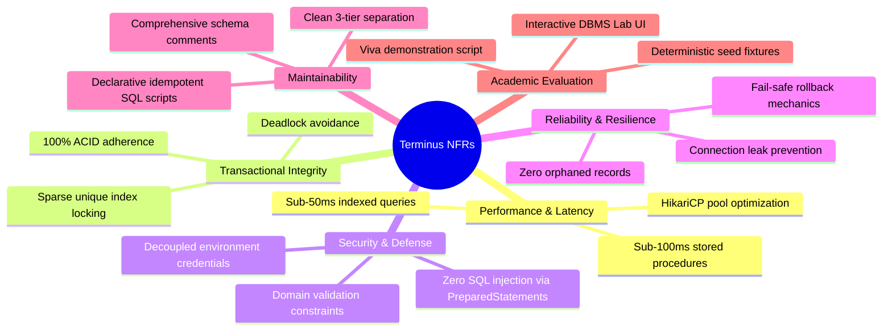
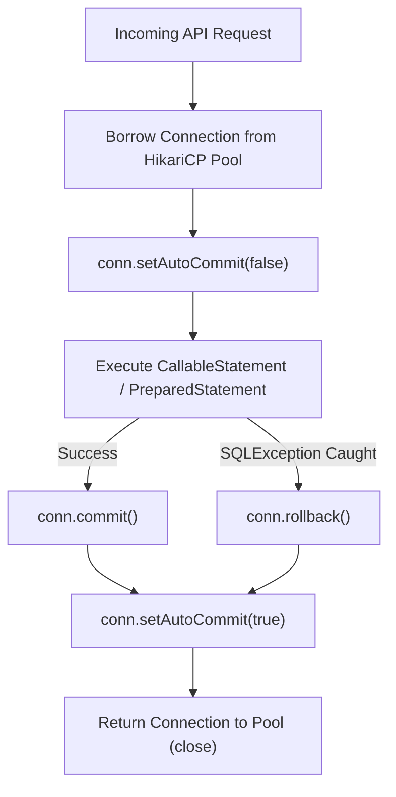

# Non-Functional Requirements Specification

**Course Code:** BCSE302L — Database Management Systems  
**Project Title:** Terminus: High-Integrity Railway Reservation & Inventory Management System  
**Document Ref:** `docs/NON_FUNCTIONAL_REQUIREMENTS.md`  

---

## 1. Overview & Quality Framework

While Functional Requirements specify *what* the system must do, Non-Functional Requirements (NFRs) specify *how well* the system must perform its operational duties. In the context of an enterprise DBMS course project (**BCSE302L**), NFRs provide benchmarkable criteria for transactional latency, concurrency throughput, mathematical data integrity, SQL injection defense, and software maintainability.

The quality attributes for **Terminus** are grouped into six core dimensions:

---

## 2. Performance & Latency Requirements

| Metric / Attribute | Requirement Specification | Measurement Mechanism | Architectural Implementation |
| :--- | :--- | :--- | :--- |
| **Point Lookup Latency** | All single-row indexed queries (`STATION` by code, `TRAIN` by number, `RESERVATION` by PNR) must execute in **$\le 10$ milliseconds**. | Spring Boot `StopWatch` / Oracle `V$SQL` elapsed time. | B-Tree unique indexes: `IDX_STATION_CODE`, `IDX_TRAIN_NUMBER`, `IDX_RESERVATION_PNR`. |
| **Complex Search Latency** | Multi-table train search between station pairs (Q01) across multiple schedules must return in **$\le 50$ milliseconds**. | Spring Boot API instrumentation; Database Lab profiler. | Join indexes on `TRAIN_STOP(station_id)` and `TRAIN_SCHEDULE(train_id, journey_date)`. |
| **Transactional Procedure Throughput** | Execution of `P_BOOK_TICKET` including schedule locking, fare math, reservation insertion, and payment trigger must complete in **$\le 80$ milliseconds**. | Backend JDBC timer logs; PL/SQL test harnesses. | Encapsulated execution inside Oracle PL/SQL engine; zero network round-trips for intermediate steps. |
| **Connection Pool Saturation** | Backend must manage up to 10 concurrent database connections with an acquisition timeout of $\le 20,000$ ms. | HikariCP MBean metrics (`HikariPool-1.getActiveConnections()`). | HikariCP pool sized to `maximum-pool-size=10`, `minimum-idle=2`, `idle-timeout=30000`. |
| **Resource Reclamation** | Batch stale reservation sweeps (`P_EXPIRE_STALE_RESERVATIONS`) must process $\ge 1,000$ expired holds in $\le 2$ seconds. | Cursor execution loop benchmark. | Explicit cursor `c_stale` using `WHERE CURRENT OF` avoiding full table scans. |

---

## 3. Relational Integrity & Concurrency Guarantees

### 3.1 Strict ACID Compliance
1. **Atomicity (All-or-Nothing):** If any sub-step within `P_BOOK_TICKET` fails (e.g., payment declined or invalid station sequence), the caller issues `ROLLBACK`, guaranteeing that zero partial reservation or payment rows are written to disk.
2. **Consistency (Invariant Preservation):** The database transition must always move from one valid relational state to another. Constraints (`CHECK`, `FOREIGN KEY`, `NOT NULL`, `UNIQUE`) and row triggers are evaluated in-flight, preventing invalid state commits.
3. **Isolation (Read Committed & Serialization):**
   - The Oracle engine runs under **Read Committed** isolation.
   - Competing transactions attempting to reserve the same physical seat on the same train schedule are serialized via explicit row-level locks (`SELECT ... FOR UPDATE`) and backed by the physical function-based unique index `IDX_ACTIVE_SEAT_RESERVATION`.
4. **Durability (Redo Log Persistence):** Once a connection issues `COMMIT`, Oracle flushes the redo log buffer to disk, ensuring that all reservation and payment records survive server power resets or application crashes.

### 3.2 Deadlock Resilience
- **Lock Acquisition Ordering:** The system must strictly acquire locks in canonical hierarchical order:
  $$\text{TRAIN\_SCHEDULE} \longrightarrow \text{SEAT} \longrightarrow \text{RESERVATION}$$
- Any operation violating this order is prohibited, eliminating cyclic lock dependencies and preventing `ORA-00060: deadlock detected while waiting for resource`.

---

## 4. Security & Data Protection

| Security Category | Requirement & Enforcement Policy | Implementation Evidence |
| :--- | :--- | :--- |
| **SQL Injection Prevention** | 100% of user-supplied dynamic inputs must be parameterized. String concatenation in dynamic SQL statements is strictly prohibited. | Spring `JdbcTemplate` and native `java.sql.PreparedStatement` / `CallableStatement` with positional binding (`?`). |
| **Credential Decoupling** | Database usernames, passwords, connection URLs, and server ports must never be hardcoded into source code. | Decoupled via `application.properties` and externalized `.env` environment variables (`ORACLE_USER`, `ORACLE_PASSWORD`). |
| **Domain Constraint Defense** | Malformed data (e.g., negative fare amounts, invalid gender categories, invalid train types) must be rejected by the database engine regardless of client validation. | Relational `CHECK` constraints: `chk_res_fare`, `chk_passenger_gender`, `chk_train_type`, `chk_pay_amount`. |
| **Least Privilege Design** | The application user `railway_user` owns and operates solely within its authorized schema scope, without administrative DBA privileges (`SYSDBA`). | Oracle DDL grants restricted to `CONNECT`, `RESOURCE`, and quota on `USERS` tablespace. |

---

## 5. Reliability & Fault Tolerance

1. **Deterministic Connection Cleanup:** Every JDBC connection borrowed from the pool must be wrapped in `try-with-resources` or explicit `finally` blocks, ensuring that `conn.close()` is executed under all execution conditions to prevent pool starvation.
2. **Zero Orphaned State:** When simulated payment status evaluates to `FAILED`, the application issues an immediate `ROLLBACK`, cleaning up any intermediate reservation state.
3. **Graceful Error Translation:** Raw Oracle database error codes are trapped and translated into structured, meaningful JSON error responses by `GlobalExceptionHandler`:
   - `ORA-00001` $\rightarrow$ `DuplicateResourceException` (HTTP 409 Conflict)
   - `ORA-02291` $\rightarrow$ `ResourceNotFoundException` (HTTP 404 Not Found)
   - `ORA-20001` through `ORA-20030` $\rightarrow$ `BusinessException` (HTTP 400 Bad Request)

---

## 6. Maintainability & Code Quality

- **Layered Architecture:** Clear decoupling between Presentation (React), Controller (REST endpoints), Service (orchestration), and Repository (JDBC SQL/PLSQL execution).
- **Schema Idempotency:** The database creation suite (`database/run_all.sql`) must be fully idempotent, dropping prior sequences and tables in reverse foreign key order before rebuilding the catalog.
- **Data Dictionary Documentation:** Every table and column in the schema is documented directly within Oracle's data dictionary using `COMMENT ON TABLE` and `COMMENT ON COLUMN` DDL statements.

---

## 7. Usability & Academic Context Suitability

1. **Demonstration Readiness (Viva / Review III):**
   - The system includes a ready-to-execute SQL script suite (`database/11_transaction_demos.sql`, `database/12_acid_tests.sql`, `database/13_concurrency_tests.sql`) that prints human-readable verification outputs directly to `DBMS_OUTPUT`.
2. **Interactive Database Operations Lab:**
   - A dedicated graphical UI tab allows instructors and students to execute any of the 18 SQL queries (Q01-Q18) on demand, view visual query results, and review execution latencies without needing SQL*Plus terminal access.
3. **Deterministic Seed Fixtures:**
   - Script `database/09_insert_seed_data.sql` populates exactly 10 stations, 4 major express trains, 100+ physical seats, 8 realistic train schedules, 10 passengers, 10 reservations, and 10 payments, providing a predictable dataset for live academic evaluation.
