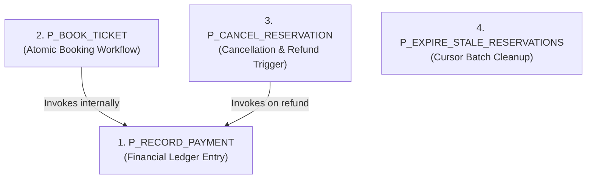

# PL/SQL Engine Specification & Procedural Catalog

**Course Code:** BCSE302L — Database Management Systems  
**Project Title:** Terminus: High-Integrity Railway Reservation & Inventory Management System  
**Document Ref:** `docs/PL_SQL_DOCUMENTATION.md`  

---

## 1. Architectural Philosophy of the PL/SQL Tier

The **Terminus Railway Reservation System** executes all operational business logic, invariant validations, and transactional state mutations directly within **Oracle Database 19c PL/SQL**. 

### Core Engineering Principles:
1. **Zero Intermediate Network Round-Trips:** Multi-step workflows (e.g., verifying seat ownership, calculating distance fares, inserting pending holds, and settling payments) execute entirely within the Oracle System Global Area (SGA) buffer cache.
2. **Caller-Controlled Transaction Demarcation:** In accordance with enterprise transactional patterns, **none of the stored procedures issue an internal `COMMIT` or `ROLLBACK`**. The caller (Java JDBC connection or testing script) maintains complete sovereignty over the transaction boundary, enabling multi-statement atomic commits or rollbacks to savepoints.
3. **Pessimistic Concurrency at the Core:** Row-level locks (`SELECT ... FOR UPDATE`) are acquired systematically inside procedures to eliminate race conditions before records are modified.

---

## 2. Stored Procedures Catalog (4 Procedures)



---

### 2.1 Procedure: `P_RECORD_PAYMENT`
- **Purpose:** Inserts payment or refund transaction records into `PAYMENT`, generates a unique transaction reference (`TXN...`), acquires row locks on the parent reservation, and strictly validates reservation status prerequisites.
- **Header Signature:**
  ```sql
  PROCEDURE P_RECORD_PAYMENT (
      p_reservation_id IN NUMBER,
      p_amount         IN NUMBER,
      p_payment_method IN VARCHAR2,
      p_payment_status IN VARCHAR2
  );
  ```
- **Parameters:**
  - `p_reservation_id` (`IN NUMBER`): Foreign key referencing `RESERVATION`.
  - `p_amount` (`IN NUMBER`): Monetary amount in INR ($\ge 0$).
  - `p_payment_method` (`IN VARCHAR2`): Channel (`'UPI'`, `'CARD'`, `'NET_BANKING'`, `'CASH'`, `'REFUND'`).
  - `p_payment_status` (`IN VARCHAR2`): Outcome (`'SUCCESS'`, `'FAILED'`, `'REFUND_SUCCESS'`).
- **Execution Logic Steps:**
  1. **Lock & Verify Reservation:** Queries `booking_status` and `fare_amount` from `RESERVATION` using `FOR UPDATE`. If record does not exist, raises error `-20019`.
  2. **Payment Prerequisite Check:** If `p_payment_status` is `SUCCESS` or `FAILED`, verifies that `RESERVATION.booking_status = 'PENDING'`. If not, raises error `-20020`.
  3. **Refund Prerequisite Check:** If `p_payment_status` is `REFUND_SUCCESS`, verifies that `RESERVATION.booking_status = 'CANCELLED'`. If not, raises error `-20021`.
  4. **Generate Reference Code:** Generates unique transaction code:
     $$\text{v\_txn\_ref} := \text{'TXN'} \;\|\; \text{LPAD}(\text{SEQ\_TXN\_REF.NEXTVAL}, 12, '0')$$
  5. **Insert Payment Ledger:** Inserts into `PAYMENT` with `SYSTIMESTAMP`.
- **Exception Handling:**
  - `ORA-20019`: Reservation ID does not exist.
  - `ORA-20020`: Payment recording rejected; reservation must be `PENDING`.
  - `ORA-20021`: Refund recording rejected; reservation must be `CANCELLED`.
- **Application Layer Usage:** Called internally by `P_BOOK_TICKET` and `P_CANCEL_RESERVATION`, and exposed via `PaymentRepository.processPayment()`.

---

### 2.2 Procedure: `P_BOOK_TICKET`
- **Purpose:** Orchestrates the end-to-end atomic ticket booking workflow: locking the schedule, validating route stops, checking seat ownership, verifying seat availability, calculating fare, inserting a `PENDING` reservation, and settling payment.
- **Header Signature:**
  ```sql
  PROCEDURE P_BOOK_TICKET (
      p_passenger_id              IN  NUMBER,
      p_schedule_id               IN  NUMBER,
      p_source_station_id         IN  NUMBER,
      p_dest_station_id           IN  NUMBER,
      p_seat_id                   IN  NUMBER,
      p_payment_method            IN  VARCHAR2,
      p_simulated_payment_status  IN  VARCHAR2,
      p_reservation_id            OUT NUMBER,
      p_pnr                       OUT VARCHAR2,
      p_fare_amount               OUT NUMBER,
      p_booking_status            OUT VARCHAR2
  );
  ```
- **Parameters:**
  - `p_passenger_id` (`IN NUMBER`): Passenger surrogate key.
  - `p_schedule_id` (`IN NUMBER`): Target train schedule.
  - `p_source_station_id` (`IN NUMBER`): Boarding station ID.
  - `p_dest_station_id` (`IN NUMBER`): Deboarding station ID.
  - `p_seat_id` (`IN NUMBER`): Allocated physical seat ID.
  - `p_payment_method` (`IN VARCHAR2`): Chosen payment channel.
  - `p_simulated_payment_status` (`IN VARCHAR2`): Simulation input (`'SUCCESS'` or `'FAILED'`).
  - `p_reservation_id` (`OUT NUMBER`): Generated surrogate reservation key.
  - `p_pnr` (`OUT VARCHAR2`): Generated 10-character PNR string.
  - `p_fare_amount` (`OUT NUMBER`): Dynamically computed fare.
  - `p_booking_status` (`OUT VARCHAR2`): Final reservation status (`'CONFIRMED'` or `'PENDING'`).
- **Execution Logic Steps:**
  1. **Passenger Existence:** Validates `passenger_id` against `PASSENGER` (raises `-20010` if missing).
  2. **Pessimistic Schedule Locking:** Executes `SELECT train_id, schedule_status FROM TRAIN_SCHEDULE WHERE schedule_id = p_schedule_id FOR UPDATE` (raises `-20011` if missing or status $\ne$ `'SCHEDULED'`).
  3. **Seat Ownership Validation:** Verifies that `SEAT.train_id` matches the schedule's assigned train (raises `-20012` if mismatched).
  4. **Route Station & Direction Checks:** Retrieves `stop_sequence` for source and destination from `TRAIN_STOP`. Verifies $Seq_{src} < Seq_{dest}$ (raises `-20013` if invalid or reversed).
  5. **Seat Contention Check:** Queries `RESERVATION` for active bookings (`PENDING` or `CONFIRMED`) on `(schedule_id, seat_id)`. If count $> 0$, raises error `-20014`.
  6. **Fare Calculation:** Invokes `F_CALCULATE_FARE` to compute distance- and class-based fare.
  7. **Key & PNR Generation:** Draws next values from `SEQ_RESERVATION_ID` and `SEQ_PNR` (`'PNR' || LPAD(SEQ_PNR.NEXTVAL, 10, '0')`).
  8. **Insert Reservation:** Inserts new row with status `'PENDING'`.
  9. **Record Payment:** Invokes `P_RECORD_PAYMENT`. If status is `'SUCCESS'`, database trigger `TRG_SYNC_RESERVATION_ON_PAYMENT` fires immediately and updates status to `'CONFIRMED'`.
  10. **Re-Read Final Status & Populate OUTs:** Reads confirmed status and returns values to caller.
- **Exception Handling:**
  - `ORA-20010`: Passenger ID does not exist.
  - `ORA-20011`: Schedule does not exist or is not in `SCHEDULED` status.
  - `ORA-20012`: Seat does not belong to scheduled train.
  - `ORA-20013`: Invalid route stops or reverse travel direction.
  - `ORA-20014`: Seat is already reserved on this schedule.
- **Application Layer Usage:** Executed via `ReservationRepository.bookTicket()` using `java.sql.CallableStatement`.

---

### 2.3 Procedure: `P_CANCEL_RESERVATION`
- **Purpose:** Cancels an existing `CONFIRMED` or `PENDING` reservation, releases the allocated seat hold immediately, and computes and logs an automated refund transaction.
- **Header Signature:**
  ```sql
  PROCEDURE P_CANCEL_RESERVATION (
      p_pnr            IN  VARCHAR2,
      p_result         OUT VARCHAR2,
      p_booking_status OUT VARCHAR2,
      p_refund_amount  OUT NUMBER
  );
  ```
- **Parameters:**
  - `p_pnr` (`IN VARCHAR2`): 10-12 character PNR string.
  - `p_result` (`OUT VARCHAR2`): Descriptive outcome message.
  - `p_booking_status` (`OUT VARCHAR2`): Final status (`'CANCELLED'`).
  - `p_refund_amount` (`OUT NUMBER`): Net refund amount disbursed.
- **Execution Logic Steps:**
  1. **Lock Row:** Queries `reservation_id` and `booking_status` from `RESERVATION` by PNR using `FOR UPDATE` (raises `-20030` if not found).
  2. **Verify Eligibility:** Confirms status is in `('CONFIRMED', 'PENDING')`. If already `CANCELLED` or `EXPIRED`, raises `-20030`.
  3. **Calculate Refundable Balance:** Calls `F_NET_PAID_AMOUNT(v_res_id)` to aggregate prior successful captures minus prior refunds.
  4. **Update Status:** Sets `RESERVATION.booking_status = 'CANCELLED'`.
  5. **Issue Refund Ledger Record:** If net balance $> 0$, invokes `P_RECORD_PAYMENT(v_res_id, v_net_paid, 'REFUND', 'REFUND_SUCCESS')`.
- **Application Layer Usage:** Executed via `ReservationRepository.cancelTicket()` using `CallableStatement`.

---

### 2.4 Procedure: `P_EXPIRE_STALE_RESERVATIONS` (Cursor Usage)
- **Purpose:** Batch maintenance sweep identifying unconfirmed reservations in `PENDING` status exceeding retention thresholds ($N$ minutes) and transitioning them to `EXPIRED` to free up seat inventory.
- **Header Signature:**
  ```sql
  PROCEDURE P_EXPIRE_STALE_RESERVATIONS (
      p_max_age_minutes IN  NUMBER,
      p_expired_count   OUT NUMBER
  );
  ```
- **Parameters:**
  - `p_max_age_minutes` (`IN NUMBER`): Maximum hold age in minutes (e.g., 15).
  - `p_expired_count` (`OUT NUMBER`): Count of swept reservations.
- **Explicit Cursor Implementation:**
  ```sql
  CURSOR c_stale IS
      SELECT reservation_id, pnr
      FROM RESERVATION
      WHERE booking_status = 'PENDING'
        AND booking_timestamp < SYSTIMESTAMP - NUMTODSINTERVAL(p_max_age_minutes, 'MINUTE')
      FOR UPDATE;
  ```
- **Execution Logic Steps:**
  1. Opens explicit cursor `c_stale`.
  2. Iterates in a `LOOP`, fetching rows into record variable `v_rec`.
  3. Exits loop when `c_stale%NOTFOUND`.
  4. For each row, executes:
     ```sql
     UPDATE RESERVATION
     SET booking_status = 'EXPIRED'
     WHERE CURRENT OF c_stale;
     ```
  5. Increments counter `v_count`.
  6. Closes cursor and assigns `p_expired_count := v_count`.
- **Application Layer Usage:** Executed periodically via Spring scheduled task or triggered on demand via `AdminController.expirePendingReservations()`.

---

## 3. Stored Functions Catalog (3 Functions)

---

### 3.1 Function: `F_CALCULATE_FARE`
- **Purpose:** Computes ticket fare deterministically based on travel distance between source and destination stations and coach class rate multipliers, enforcing a minimum fare floor of ₹50.00.
- **Signature:**
  ```sql
  FUNCTION F_CALCULATE_FARE (
      p_schedule_id          IN NUMBER,
      p_source_station_id    IN NUMBER,
      p_dest_station_id      IN NUMBER,
      p_seat_id              IN NUMBER
  ) RETURN NUMBER;
  ```
- **Multiplier Matrix:**
  $$\text{Multiplier} = \begin{cases}
  0.50 & \text{for Sleeper (SL)} \\
  1.20 & \text{for AC 3-Tier (3A)} \\
  1.80 & \text{for AC 2-Tier (2A)} \\
  3.00 & \text{for AC First Class (1A)} \\
  1.50 & \text{for AC Chair Car (CC)} \\
  0.30 & \text{for Second Sitting (2S)} \\
  2.50 & \text{for Exec Chair Car (EC)}
  \end{cases}$$
- **Formula:**
  $$\text{BaseFare} = (\text{Dist}_{dest} - \text{Dist}_{src}) \times \text{Multiplier}$$
  $$\text{FinalFare} = \max(50.00, \; \text{ROUND}(\text{BaseFare}, 2))$$
- **Exception Codes:**
  - `ORA-20015`: Travel distance $\le 0$ ($Dist_{dest} \le Dist_{src}$).
  - `ORA-20016`: Station, schedule, or seat not found on route.

---

### 3.2 Function: `F_AVAILABLE_SEAT_COUNT`
- **Purpose:** Returns total remaining unbooked seats for a train schedule, optionally filtered by travel class, excluding seats tied to active reservations (`PENDING` or `CONFIRMED`).
- **Signature:**
  ```sql
  FUNCTION F_AVAILABLE_SEAT_COUNT (
      p_schedule_id    IN NUMBER,
      p_coach_class    IN VARCHAR2 DEFAULT NULL
  ) RETURN NUMBER;
  ```
- **Implementation Mechanism:** Queries `SEAT` filtered by `train_id`, excluding `seat_id` values present in:
  ```sql
  SELECT r.seat_id FROM RESERVATION r
  WHERE r.schedule_id = p_schedule_id
    AND r.seat_id IS NOT NULL
    AND r.booking_status IN ('PENDING', 'CONFIRMED')
  ```

---

### 3.3 Function: `F_NET_PAID_AMOUNT`
- **Purpose:** Computes the net settled monetary balance for a reservation by aggregating successful payments and subtracting successful refunds.
- **Signature:**
  ```sql
  FUNCTION F_NET_PAID_AMOUNT (
      p_reservation_id IN NUMBER
  ) RETURN NUMBER;
  ```
- **Mathematical Formula:**
  $$\text{NetPaid} = \sum \text{Amount}_{(\text{status='SUCCESS'})} - \sum \text{Amount}_{(\text{status='REFUND\_SUCCESS'})}$$

---

## 4. Database Triggers Catalog (2 Triggers)

---

### 4.1 Trigger: `TRG_VALIDATE_RESERVATION`
- **Timing & Scope:** `BEFORE INSERT OR UPDATE ON RESERVATION FOR EACH ROW`
- **Bypass Rule:** If `:NEW.booking_status IN ('CANCELLED', 'EXPIRED')`, validation is skipped immediately to allow status updates without overhead.
- **Validation Rules:**
  1. Verifies that `schedule_id` exists in `TRAIN_SCHEDULE` (raises `-20001`).
  2. Verifies that `source_station_id` exists in `TRAIN_STOP` for that train (raises `-20002`).
  3. Verifies that `destination_station_id` exists in `TRAIN_STOP` for that train (raises `-20003`).
  4. Verifies stop sequence ordering: $Seq_{src} < Seq_{dest}$ (raises `-20004`).
  5. If `seat_id` is non-null, verifies that the seat belongs to the schedule's assigned train (raises `-20005`).

---

### 4.2 Trigger: `TRG_SYNC_RESERVATION_ON_PAYMENT`
- **Timing & Scope:** `AFTER INSERT ON PAYMENT FOR EACH ROW`
- **Synchronization Logic:**
  ```sql
  IF :NEW.payment_status = 'SUCCESS' THEN
      UPDATE RESERVATION
      SET booking_status = 'CONFIRMED'
      WHERE reservation_id = :NEW.reservation_id
        AND booking_status = 'PENDING';
  END IF;
  ```
- **Operational Impact:** Eliminates the need for application code to issue a secondary update statement to confirm the booking, ensuring that booking confirmation is tightly coupled to payment insertion at the database kernel level.

---

## 5. Master Oracle Error Code Mapping Catalog

| Error Code | Triggering Component | Condition / Cause |
| :--- | :--- | :--- |
| `ORA-20001` | `TRG_VALIDATE_RESERVATION` | Specified `schedule_id` does not exist in `TRAIN_SCHEDULE`. |
| `ORA-20002` | `TRG_VALIDATE_RESERVATION` | Source station does not belong to the train's route itinerary. |
| `ORA-20003` | `TRG_VALIDATE_RESERVATION` | Destination station does not belong to the train's route itinerary. |
| `ORA-20004` | `TRG_VALIDATE_RESERVATION` | Reverse sequence: Source stop sequence $\ge$ Destination stop sequence. |
| `ORA-20005` | `TRG_VALIDATE_RESERVATION` | Allocated seat does not belong to the train assigned to this schedule. |
| `ORA-20010` | `P_BOOK_TICKET` | Passenger ID does not exist in `PASSENGER`. |
| `ORA-20011` | `P_BOOK_TICKET` | Schedule ID does not exist or status is not `SCHEDULED`. |
| `ORA-20012` | `P_BOOK_TICKET` | Seat ID does not belong to the schedule's train. |
| `ORA-20013` | `P_BOOK_TICKET` | Route station validation failed or reverse travel direction. |
| `ORA-20014` | `P_BOOK_TICKET` | Seat is already actively booked (`PENDING` or `CONFIRMED`) on this schedule. |
| `ORA-20015` | `F_CALCULATE_FARE` | Distance calculation error: Destination distance $\le$ Source distance. |
| `ORA-20016` | `F_CALCULATE_FARE` | Schedule, station, or seat entity not found in route. |
| `ORA-20019` | `P_RECORD_PAYMENT` | Target reservation ID does not exist in `RESERVATION`. |
| `ORA-20020` | `P_RECORD_PAYMENT` | Payment rejected: Reservation status must be `PENDING`. |
| `ORA-20021` | `P_RECORD_PAYMENT` | Refund rejected: Reservation status must be `CANCELLED`. |
| `ORA-20030` | `P_CANCEL_RESERVATION` | Cancellation rejected: PNR does not exist or is already `CANCELLED`/`EXPIRED`. |
