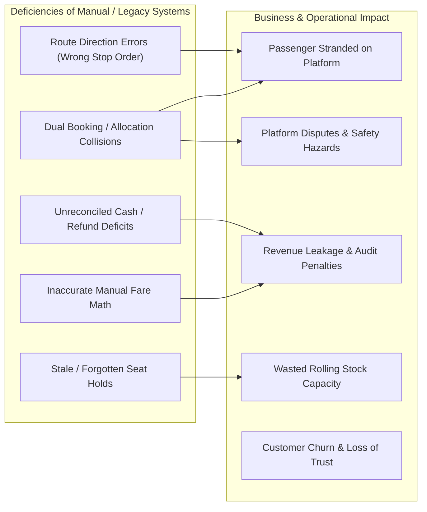
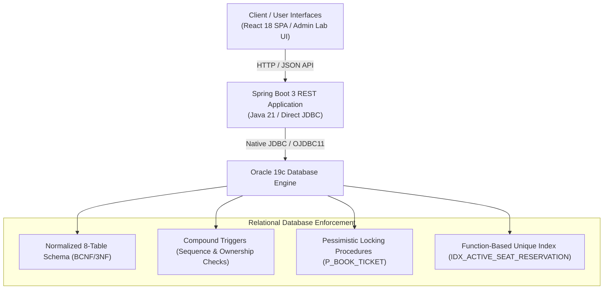

# Problem Definition & System Rationale

**Course Code:** BCSE302L — Database Management Systems  
**Project Title:** Terminus: High-Integrity Railway Reservation & Inventory Management System  
**Document Ref:** `docs/PROBLEM_DEFINITION.md`  

---

## 1. Problem Statement

Railway transportation serves as the backbone of national transit infrastructure, transporting tens of millions of passengers daily across networks spanning thousands of kilometers and hundreds of interconnected stations. Historically and in legacy manual environments, passenger reservations were handled through centralized physical ledgers, teleprinted manifests, or loosely coupled station logs. 

In the absence of a centralized, transactional Relational Database Management System (RDBMS) governed by strict mathematical constraints and ACID transaction guarantees, railway reservation systems suffer catastrophic operational bottlenecks:
1. **Physical Ledger Divergence:** Ticket issuing clerks at disparate terminal locations operate on desynchronized paper sheets or disconnected databases, inevitably selling the identical berth on the identical train schedule to different passengers.
2. **Intermediate Route Inefficiency:** Trains travel through multiple intermediate stations. In a manual system, determining whether a berth vacated at station $K$ can be legally and safely allocated to a passenger boarding at station $K+1$ without clashing with a downstream passenger requires cumbersome manual cross-referencing, leading to massive seat under-utilization or severe double-booking.
3. **Transaction Fragmentation:** When cash payments are handed to a clerk or an unverified token is presented, network disconnects or human disruptions result in tickets being issued without recorded revenue, or payments captured without confirmed seat allocations.
4. **Cancellation and Refund Auditing Chaos:** Processing ticket cancellations through manual ledgers requires manual calculation of cancellation fees, opening avenues for accounting discrepancies, fraudulent re-allocations, and delayed customer reimbursements.

Consequently, there is an imperative academic and industrial need for a computerized, robust, multi-tier Railway Reservation System that shifts business rules into an ACID-compliant relational core, guaranteeing data integrity, deterministic concurrency control, and zero human calculation errors.

---

## 2. Current Challenges in Manual and Legacy Booking Systems

### 2.1 Double-Booking and Inventory Desynchronization
When booking requests arrive concurrently from geographically separated booking counters, two clerks examining an identical physical seat manifest simultaneously observe the seat as "vacant." Both proceed to write out a ticket and collect fare. Without an atomic, pessimistic record lock (`SELECT FOR UPDATE`) and a database-enforced physical uniqueness constraint, both transactions succeed, resulting in two passengers holding legal tickets for a single physical berth.

### 2.2 Lack of Intermediate Station Sequence Verification
Train lines are strictly directed routes characterized by monotonically increasing stop sequences:
$$\text{Station } S_1 \xrightarrow{} \text{Station } S_2 \xrightarrow{} \dots \xrightarrow{} \text{Station } S_n$$
Manual systems frequently issue tickets with reverse sequences (e.g., boarding at Stop 5 to deboard at Stop 2 on a northbound service) or issue tickets between stations that do not belong to the train's registered timetable. Preventing this requires database-level trigger validation that validates stop order sequences before committing row inserts.

### 2.3 Non-Deterministic and Error-Prone Fare Computation
Fare calculation in modern rail transit is governed by multi-variable formulas:
$$\text{Fare} = \max\left(\text{MinFare}, \; \Delta\text{Distance}(\text{km}) \times \text{ClassMultiplier}\right)$$
Manual computation by clerks introduces calculation errors, vulnerability to clerical discretion, inconsistent concession applications, and audit failures. A computerized system must compute fares deterministically inside a database function (`F_CALCULATE_FARE`), guaranteeing uniform rates across all transactions.

### 2.4 Stale Reservation Holds and Phantom Capacity
When passengers initiate reservations, seats must be temporarily reserved while payment is tendered. In manual systems, clerks hold seats by marking them in pencil; if the customer walks away without paying, the pencil mark remains, causing the seat to go unoccupied on departure day. An automated system must implement an automated cursor-based batch sweep (`P_EXPIRE_STALE_RESERVATIONS`) that automatically purges unfinalized holds exceeding an age threshold.

### 2.5 Refund Discrepancies and Ledger Reconciliations
When a ticket is cancelled, manual systems rely on clerks to deduct administrative charges and pay cash from physical tills. Ledger mismatches occur when tickets are cancelled without recording refunds, or refunds are recorded for tickets that were never paid for. An automated relational database links every refund record directly to its parent reservation and primary payment transaction through foreign key relations.

---

## 3. The Proposed Solution: Terminus DBMS Architecture

**Terminus** resolves these challenges by combining a 3-tier architecture with an **Oracle 19c Enterprise relational engine**.

### Core Innovations of the Solution:
1. **Mathematical Relational Schema:** An 8-table normalized core ensuring that train definitions, routes, physical coach inventory, calendar runs, bookings, and payments are decoupled without redundant duplication.
2. **Database-Enforced Concurrency Control:**
   - Explicit row-level locking via `SELECT FOR UPDATE` within stored procedures serializes competing booking threads.
   - A specialized function-based unique index `IDX_ACTIVE_SEAT_RESERVATION` unconditionally blocks race conditions at the physical B-tree index level, even in the event of application logic failure.
3. **Pessimistic Stored Procedures:** All state mutations (`P_BOOK_TICKET`, `P_RECORD_PAYMENT`, `P_CANCEL_RESERVATION`) are executed within PL/SQL procedures where transactions are kept open for caller-controlled atomicity (`commit` or `rollback`).
4. **Self-Healing Seat Allocation:** When a reservation transitions from `CONFIRMED` to `CANCELLED`, the function-based index expression evaluates to `NULL`. Because Oracle excludes all-null tuples from composite unique indexes, the seat becomes instantaneously available for re-allocation to other passengers without requiring background defragmentation.

---

## 4. Target User Personas & Use-Case Mapping

| Persona | Role Description | Primary Operational Needs | System Modules Utilized |
| :--- | :--- | :--- | :--- |
| **Railway Passenger** | General traveler or commuter booking intercity journeys. | Search routes between two stations on a date; check real-time class availability; select specific coach and berth; complete booking; retrieve PNR status; cancel ticket and receive refund. | Train Search UI, Interactive Seat Map, PNR Inquiry, Payment Simulation, Self-Service Cancellation. |
| **Booking Clerk / Agent** | Railway counter representative issuing tickets to walk-in passengers. | High-throughput terminal booking; rapid PNR lookup; real-time coach availability; instant seat lock without system lag or concurrency crashes. | Native JDBC Booking API, `P_BOOK_TICKET` procedure, `F_AVAILABLE_SEAT_COUNT` function. |
| **System Administrator** | Railway operational officer managing infrastructure and rolling stock. | Create new stations, trains, routes, and calendar schedules; manage seat layouts; monitor system health; trigger batch maintenance sweeps. | Admin Dashboard, Station/Train CRUD APIs, Schedule Dispatcher, `P_EXPIRE_STALE_RESERVATIONS`. |
| **Financial / Revenue Auditor** | Accounting officer inspecting transaction ledgers and yield. | Audit daily station revenue; reconcile payment settlements against refund ledgers; detect discrepancies; track revenue yield per passenger-kilometer. | Analytic Views, Query Lab (Q04, Q09, Q10, Q12), `F_NET_PAID_AMOUNT`. |
| **DBMS Course Faculty / Evaluator** | Academic instructor assessing relational design and SQL/PLSQL implementation. | Inspect table constraints; review normalization proofs; evaluate JDBC code patterns; execute ACID test scripts; verify isolation levels and lock ordering. | **Database Operations Lab**, ACID Verification Suite, Concurrency Stress Test Harness. |
