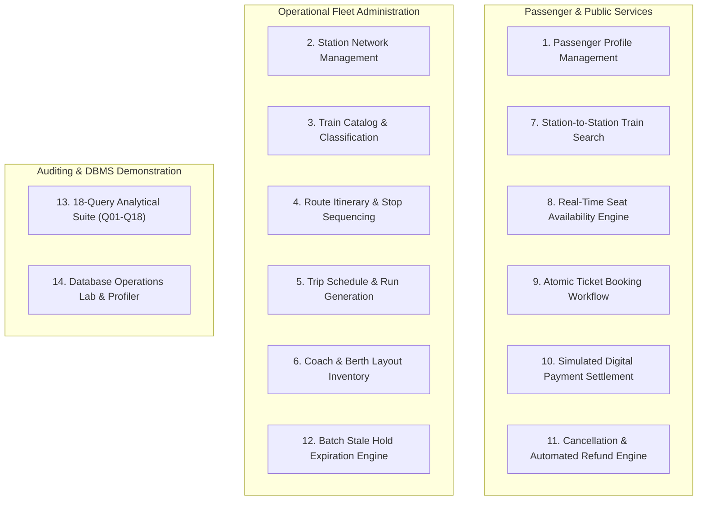

# Project Scope, Boundaries & Academic Disclaimers

**Course Code:** BCSE302L — Database Management Systems  
**Project Title:** Terminus: High-Integrity Railway Reservation & Inventory Management System  
**Document Ref:** `docs/PROJECT_SCOPE.md`  

---

## 1. System Scope Overview

The **Terminus Railway Reservation System** is architected to represent the transactional data management core of an enterprise rail transportation network. The scope encompasses the entire database lifecycle: schema modeling, physical constraint enforcement, concurrency control, transaction isolation, business procedure execution, and reporting.

To maintain pedagogical rigor within the confines of **BCSE302L Database Management Systems**, clear boundaries are established between in-scope features, out-of-scope enterprise integrations, and operational assumptions.

---

## 2. In-Scope Functional Modules (14 Core Features)

The system provides 14 core functional capabilities spanning user operations, administrative maintenance, and database engineering:

### Detailed Functional Breakdown

| Feature ID | Functional Domain | Scope & Description | Key Artifacts |
| :---: | :--- | :--- | :--- |
| **F-01** | **Passenger Profiles** | Registration and CRUD management of passenger profiles including unique phone, unique email, date of birth, and gender check. | `PASSENGER` table, `PassengerRepository` |
| **F-02** | **Station Directory** | Master registry of physical railway junction stations across cities and states with unique official railway codes (e.g., NDLS, BCT). | `STATION` table, `StationRepository` |
| **F-03** | **Train Master Catalog** | Classification of trains into categories (Rajdhani, Shatabdi, Superfast, Express, Mail) with active operational state tracking. | `TRAIN` table, `TrainRepository` |
| **F-04** | **Route & Stop Sequencing** | Ordered sequence of station stops, cumulative distances in kilometers from origin, and scheduled arrival/departure times. | `TRAIN_STOP` table, `chk_stop_dist` |
| **F-05** | **Trip Schedule Generation** | Calendar-specific train departures, linking physical train sets to specific departure dates and trip run statuses. | `TRAIN_SCHEDULE` table, `ScheduleRepository` |
| **F-06** | **Coach & Seat Inventory** | Layout configuration mapping train rakes to coach numbers (S1, B1, A1), seat numbers, coach classes (1A, 2A, 3A, SL, CC), and berth types. | `SEAT` table, `SeatRepository` |
| **F-07** | **Train Search Engine** | Complex multi-join search finding all active trains connecting two stations on or after a travel date where stop sequence $Seq_{src} < Seq_{dest}$. | SQL Query Q01, `TrainController` |
| **F-08** | **Seat Availability Matrix** | Real-time computation of vacant seats per train schedule and travel class, filtering out actively held and confirmed bookings. | `F_AVAILABLE_SEAT_COUNT`, SQL Query Q02 |
| **F-09** | **Atomic Ticket Booking** | Pessimistic locking of train schedules and seats, dynamic fare computation, PNR generation, and reservation insertion. | `P_BOOK_TICKET`, `ReservationRepository` |
| **F-10** | **Simulated Payment Settlement** | Gateway payment settlement simulation supporting UPI, CARD, NET_BANKING, and CASH channels, triggering booking confirmation. | `P_RECORD_PAYMENT`, `TRG_SYNC_RESERVATION_ON_PAYMENT` |
| **F-11** | **Cancellation & Refund Reconciliation** | Atomic cancellation of reservations, seat release, and automated refund logging based on net captured funds. | `P_CANCEL_RESERVATION`, `F_NET_PAID_AMOUNT` |
| **F-12** | **Batch Stale Hold Expiration** | Automated cursor-driven sweep expiring unconfirmed reservations exceeding retention thresholds to release held inventory. | `P_EXPIRE_STALE_RESERVATIONS`, `c_stale` Cursor |
| **F-13** | **Analytical Reporting Suite** | 18 analytical SQL queries providing route popularity, occupancy rates, station congestion, class yield, and double-booking audits. | SQL Queries Q01 through Q18, `ReportRepository` |
| **F-14** | **Database Operations Lab** | Interactive administrative UI allowing faculty and students to execute queries, review schema catalogs, and measure execution latency. | `DatabaseLabController`, React Lab View |

---

## 3. Explicitly Out-of-Scope Items

To preserve project focus on core DBMS competencies, the following domains are excluded from implementation:

1. **Real-World Indian Railways (IRCTC / CRIS) Integration:** Terminus operates on a standalone, self-contained relational schema. It does not interface with live IRCTC APIs, CRIS servers, or PRS mainframe gateways.
2. **Real-Time GPS Train Telemetry:** Live train location tracking via GPS hardware, satellite telemetry, or speed sensor IoT devices is out of scope. Trip status is managed via discrete administrative status flags (`SCHEDULED`, `RUNNING`, `COMPLETED`, `CANCELLED`).
3. **Production Banking / Payment Gateways:** Direct integration with production payment gateways (e.g., Stripe, Razorpay, Visa/Mastercard payment networks) requiring PCI-DSS compliance is out of scope. All payments are simulated using internal database transactions.
4. **Third-Party Messaging Gateways:** External cellular SMS gateways (e.g., Twilio) and transactional email servers (e.g., SendGrid) are omitted. Booking confirmation details are displayed directly in the user interface.
5. **Multi-Region Georeplicated Clustering:** Distributed multi-master clustering, cross-continental active-active georeplication, and sharding architectures are out of scope. The database operates on a single-node Oracle 19c Enterprise or XE instance.

---

## 4. Key Assumptions & System Limitations

### 4.1 Academic & Technical Assumptions
- **DBMS Platform:** The relational database is assumed to be **Oracle Database 19c (Release 19.3+)** or Oracle Database Express Edition (XE 21c).
- **Driver Protocol:** The backend communicates exclusively via the **Oracle JDBC Thin Driver (`ojdbc11`)** utilizing standard TCP/IP port 1521.
- **Single Rake per Schedule:** Each train schedule references a single train rake configuration whose coach and seat inventory remains fixed for that journey date.
- **Directional Route Monotonicity:** Train routes are modeled as ordered sequences with strictly increasing distance from the origin ($0 \le \text{Dist}_{Stop1} < \text{Dist}_{Stop2} < \dots$). Round trips and return journeys are modeled as distinct train records with unique train numbers.

### 4.2 System Limitations
- **Station-to-Station Inventory Slicing:** A seat booked from intermediate Station 2 to Station 3 is marked reserved for the entire schedule run rather than segmented into piecewise sub-itineraries. This is a deliberate 8-table architectural trade-off to maintain relational clarity and prevent explosive combinatorial state explosion.
- **Single Passenger per Reservation:** Each `RESERVATION` record maps to exactly one `PASSENGER` and one `SEAT`, generating a unique PNR. Multi-passenger party bookings are accommodated by issuing separate linked reservations under identical schedule coordinates.

---

## 5. Academic Disclaimer Regarding Simulated Payments

> [!IMPORTANT]
> **ACADEMIC SIMULATION DISCLAIMER**  
> The financial transactions, payment records, bank references (`TXN...`), and refund disbursements processed by Terminus are **strictly simulated for academic demonstration purposes**. 
> 
> No actual financial instruments, credit cards, bank accounts, or digital currency are charged or transferred. The simulated payment engine (`P_RECORD_PAYMENT`) exists solely to demonstrate:
> 1. Multi-table foreign key synchronization between order and settlement entities.
> 2. Database trigger-driven state transitions (`TRG_SYNC_RESERVATION_ON_PAYMENT`).
> 3. Two-phase transaction commit and rollback mechanics.
> 4. Financial audit ledger reconciliation via SQL window functions.
