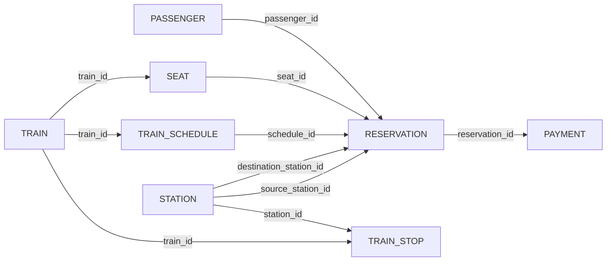

# Formal Relational Schema Specification

**Course Code:** BCSE302L — Database Management Systems  
**Project Title:** Terminus: High-Integrity Railway Reservation & Inventory Management System  
**Document Ref:** `docs/RELATIONAL_SCHEMA.md`  

---

## 1. Formal Relational Notation Standards

In standard database theory, relational schemas are formally expressed using relation signatures where:
- The **Relation Name** is written in uppercase boldface.
- The **Attributes** (columns) are enclosed in parentheses.
- **Primary Keys (PK)** are indicated by continuous underlining (`<u>attribute</u>`).
- **Composite Primary Keys** have each component attribute underlined (`<u>attr1</u>, <u>attr2</u>`).
- **Foreign Keys (FK)** are annotated with directional arrows ($\longrightarrow$) specifying the referenced parent relation.
- **Candidate / Alternate Keys (AK / UK)** are marked with a superscript $^{[AK]}$.

---

## 2. Relational Schemas for the 8 Core Tables

### 1. PASSENGER
$$\textbf{PASSENGER}\left(\underline{\text{passenger\_id}}, \text{full\_name}, \text{date\_of\_birth}, \text{gender}, \text{phone}^{[AK]}, \text{email}^{[AK]}\right)$$

- **Primary Key:** `passenger_id`
- **Candidate Keys:** `phone`, `email`
- **Foreign Keys:** None (Root Entity)

---

### 2. STATION
$$\textbf{STATION}\left(\underline{\text{station\_id}}, \text{station\_code}^{[AK]}, \text{station\_name}, \text{city}, \text{state}\right)$$

- **Primary Key:** `station_id`
- **Candidate Keys:** `station_code`
- **Foreign Keys:** None (Root Entity)

---

### 3. TRAIN
$$\textbf{TRAIN}\left(\underline{\text{train\_id}}, \text{train\_number}^{[AK]}, \text{train\_name}, \text{train\_type}, \text{active\_status}\right)$$

- **Primary Key:** `train_id`
- **Candidate Keys:** `train_number`
- **Foreign Keys:** None (Root Entity)

---

### 4. TRAIN_STOP
$$\textbf{TRAIN\_STOP}\left(\underline{\text{train\_id}}, \underline{\text{stop\_sequence}}, \text{station\_id}, \text{arrival\_time}, \text{departure\_time}, \text{distance\_from\_origin\_km}\right)$$

- **Primary Key:** `(train_id, stop_sequence)`
- **Candidate Keys:** `(train_id, station_id)`
- **Foreign Keys:**
  - $\text{train\_id} \longrightarrow \textbf{TRAIN}(\text{train\_id}) \quad [\text{ON DELETE CASCADE}]$
  - $\text{station\_id} \longrightarrow \textbf{STATION}(\text{station\_id}) \quad [\text{RESTRICT}]$

---

### 5. TRAIN_SCHEDULE
$$\textbf{TRAIN\_SCHEDULE}\left(\underline{\text{schedule\_id}}, \text{train\_id}, \text{journey\_date}, \text{scheduled\_departure}, \text{scheduled\_arrival}, \text{schedule\_status}\right)$$

- **Primary Key:** `schedule_id`
- **Candidate Keys:** `(train_id, journey_date)`
- **Foreign Keys:**
  - $\text{train\_id} \longrightarrow \textbf{TRAIN}(\text{train\_id}) \quad [\text{ON DELETE CASCADE}]$

---

### 6. SEAT
$$\textbf{SEAT}\left(\underline{\text{seat\_id}}, \text{train\_id}, \text{coach\_number}, \text{seat\_number}, \text{coach\_class}, \text{berth\_type}\right)$$

- **Primary Key:** `seat_id`
- **Candidate Keys:** `(train_id, coach_number, seat_number)`
- **Foreign Keys:**
  - $\text{train\_id} \longrightarrow \textbf{TRAIN}(\text{train\_id}) \quad [\text{ON DELETE CASCADE}]$

---

### 7. RESERVATION
$$\textbf{RESERVATION}\left(\underline{\text{reservation\_id}}, \text{pnr}^{[AK]}, \text{passenger\_id}, \text{schedule\_id}, \text{seat\_id}, \text{source\_station\_id}, \text{destination\_station\_id}, \text{booking\_timestamp}, \text{booking\_status}, \text{fare\_amount}\right)$$

- **Primary Key:** `reservation_id`
- **Candidate Keys:** `pnr`
- **Foreign Keys:**
  - $\text{passenger\_id} \longrightarrow \textbf{PASSENGER}(\text{passenger\_id}) \quad [\text{RESTRICT}]$
  - $\text{schedule\_id} \longrightarrow \textbf{TRAIN\_SCHEDULE}(\text{schedule\_id}) \quad [\text{RESTRICT}]$
  - $\text{seat\_id} \longrightarrow \textbf{SEAT}(\text{seat\_id}) \quad [\text{RESTRICT, Nullable}]$
  - $\text{source\_station\_id} \longrightarrow \textbf{STATION}(\text{station\_id}) \quad [\text{RESTRICT}]$
  - $\text{destination\_station\_id} \longrightarrow \textbf{STATION}(\text{station\_id}) \quad [\text{RESTRICT}]$

---

### 8. PAYMENT
$$\textbf{PAYMENT}\left(\underline{\text{payment\_id}}, \text{reservation\_id}, \text{amount}, \text{payment\_method}, \text{payment\_status}, \text{transaction\_reference}^{[AK]}, \text{payment\_timestamp}\right)$$

- **Primary Key:** `payment_id`
- **Candidate Keys:** `transaction_reference`
- **Foreign Keys:**
  - $\text{reservation\_id} \longrightarrow \textbf{RESERVATION}(\text{reservation\_id}) \quad [\text{RESTRICT}]$

---

## 3. Referential Integrity Vector Map

The directional graph below summarizes the foreign key dependency tree across all 8 relations:

### Referential Actions Specification Matrix

| Referential Constraint Name | Child Table | Foreign Key Attribute | Parent Referenced Table | Parent Attribute | On Delete Action | On Update Action |
| :--- | :--- | :--- | :--- | :--- | :--- | :--- |
| `fk_stop_train` | `TRAIN_STOP` | `train_id` | `TRAIN` | `train_id` | `CASCADE` | `NO ACTION` |
| `fk_stop_station` | `TRAIN_STOP` | `station_id` | `STATION` | `station_id` | `RESTRICT` | `NO ACTION` |
| `fk_sched_train` | `TRAIN_SCHEDULE` | `train_id` | `TRAIN` | `train_id` | `CASCADE` | `NO ACTION` |
| `fk_seat_train` | `SEAT` | `train_id` | `TRAIN` | `train_id` | `CASCADE` | `NO ACTION` |
| `fk_res_passenger` | `RESERVATION` | `passenger_id` | `PASSENGER` | `passenger_id` | `RESTRICT` | `NO ACTION` |
| `fk_res_schedule` | `RESERVATION` | `schedule_id` | `TRAIN_SCHEDULE` | `schedule_id` | `RESTRICT` | `NO ACTION` |
| `fk_res_seat` | `RESERVATION` | `seat_id` | `SEAT` | `seat_id` | `RESTRICT` | `NO ACTION` |
| `fk_res_src` | `RESERVATION` | `source_station_id` | `STATION` | `station_id` | `RESTRICT` | `NO ACTION` |
| `fk_res_dest` | `RESERVATION` | `destination_station_id`| `STATION` | `station_id` | `RESTRICT` | `NO ACTION` |
| `fk_pay_reservation` | `PAYMENT` | `reservation_id` | `RESERVATION` | `reservation_id` | `RESTRICT` | `NO ACTION` |
