# Review III Live Viva Demonstration Script

**Course Code:** BCSE302L — Database Management Systems  
**Project Title:** Terminus: High-Integrity Railway Reservation & Inventory Management System  
**Document Ref:** `docs/REVIEW_III_DEMONSTRATION.md`  

---

## 1. Demonstration Protocol & Evaluator Overview

This document serves as the comprehensive, scripted viva guide for the **Review III Final Demonstration** before the university faculty evaluator. 

The demonstration is organized into **9 structured interactive scenarios** showcasing the interplay between the React UI, Spring Boot JDBC layer, and Oracle Database 19c PL/SQL kernel.

```mermaid
flowchart LR
    D1["Demo 1: Booking Flow"] --> D2["Demo 2: Payment Failure"]
    D2 --> D3["Demo 3: Cancel & Refund"]
    D3 --> D4["Demo 4: Seat Conflict"]
    D4 --> D5["Demo 5: PNR Search"]
    D5 --> D6["Demo 6: Stale Expire (Cursor)"]
    D6 --> D7["Demo 7: Schedule Update"]
    D7 --> D8["Demo 8: Station CRUD"]
    D8 --> D9["Demo 9: Constraint Rejection"]
```



---

## 2. Nine Step-by-Step Demonstration Scenarios

---

### Demo 1: Successful Atomic Passenger Ticket Booking
- **DBMS Concept Shown:** Atomic transaction commit across 4 tables, pessimistic schedule locking (`FOR UPDATE`), dynamic fare math (`F_CALCULATE_FARE`), stored procedure execution (`P_BOOK_TICKET`), and trigger-driven status synchronization (`TRG_SYNC_RESERVATION_ON_PAYMENT`).
- **Operation:** Passenger 1 books Seat 1 (1A) on Schedule 2 (Mumbai Central to New Delhi) using a Credit Card with simulated `SUCCESS`.
- **Tables Involved:** `TRAIN_SCHEDULE`, `SEAT`, `RESERVATION`, `PAYMENT`.
- **SQL / PL/SQL Executed:**
  ```sql
  DECLARE
      v_res_id NUMBER; v_pnr VARCHAR2(15); v_fare NUMBER; v_status VARCHAR2(20);
  BEGIN
      P_BOOK_TICKET(
          p_passenger_id             => 1,
          p_schedule_id              => 2,
          p_source_station_id        => 2,
          p_dest_station_id          => 1,
          p_seat_id                  => 1,
          p_payment_method           => 'CARD',
          p_simulated_payment_status => 'SUCCESS',
          p_reservation_id           => v_res_id,
          p_pnr                      => v_pnr,
          p_fare_amount              => v_fare,
          p_booking_status           => v_status
      );
      COMMIT;
      DBMS_OUTPUT.PUT_LINE('Booking Success! PNR: ' || v_pnr || ' Status: ' || v_status || ' Fare: INR ' || v_fare);
  END;
  /
  ```
- **Database Effect:**
  - One row inserted into `RESERVATION` in `'PENDING'` state.
  - One row inserted into `PAYMENT` with `payment_status = 'SUCCESS'`.
  - Trigger `TRG_SYNC_RESERVATION_ON_PAYMENT` executes, updating `RESERVATION.booking_status` to `'CONFIRMED'`.
  - Explicit `COMMIT` flushes transaction to redo log.
- **Expected Output:**
  ```
  Booking Success! PNR: PNR1000000011 Status: CONFIRMED Fare: INR 4152.00
  ```
- **Verification Query:**
  ```sql
  SELECT r.pnr, r.booking_status, p.payment_status, p.amount, p.transaction_reference
  FROM RESERVATION r
  JOIN PAYMENT p ON r.reservation_id = p.reservation_id
  WHERE r.pnr = 'PNR1000000011';
  ```

---

### Demo 2: Failed Payment & Transaction Rollback
- **DBMS Concept Shown:** Atomicity guarantee, error trapping, and full rollback of uncommitted state leaving zero orphaned records.
- **Operation:** Passenger 2 attempts to book Seat 2 (1A) on Schedule 2, but payment is declined (`FAILED`).
- **Tables Involved:** `RESERVATION`, `PAYMENT`.
- **SQL / PL/SQL Executed:**
  ```sql
  DECLARE
      v_res_id NUMBER; v_pnr VARCHAR2(15); v_fare NUMBER; v_status VARCHAR2(20);
  BEGIN
      SAVEPOINT sp_before_payment;
      P_BOOK_TICKET(
          p_passenger_id             => 2,
          p_schedule_id              => 2,
          p_source_station_id        => 2,
          p_dest_station_id          => 1,
          p_seat_id                  => 2,
          p_payment_method           => 'UPI',
          p_simulated_payment_status => 'FAILED',
          p_reservation_id           => v_res_id,
          p_pnr                      => v_pnr,
          p_fare_amount              => v_fare,
          p_booking_status           => v_status
      );
      -- Simulated payment declined: roll back transaction completely
      ROLLBACK TO sp_before_payment;
      DBMS_OUTPUT.PUT_LINE('Payment declined. Rolled back transaction to savepoint.');
  END;
  /
  ```
- **Database Effect:** All intermediate inserts into `RESERVATION` and `PAYMENT` are undone from Oracle undo buffers.
- **Expected Output:**
  ```
  Payment declined. Rolled back transaction to savepoint.
  ```
- **Verification Query:**
  ```sql
  SELECT COUNT(*) AS residual_records FROM RESERVATION WHERE pnr = 'PNR1000000012';
  -- Result: 0 (Zero orphaned records)
  ```

---

### Demo 3: Reservation Cancellation with Automated Refund
- **DBMS Concept Shown:** Multi-table state transition, stored procedure `P_CANCEL_RESERVATION`, net balance math via `F_NET_PAID_AMOUNT`, automated refund logging, and immediate seat release via sparse function-based index.
- **Operation:** Cancel the ticket booked in Demo 1 using its PNR.
- **Tables Involved:** `RESERVATION`, `PAYMENT`.
- **SQL / PL/SQL Executed:**
  ```sql
  DECLARE
      v_result VARCHAR2(200); v_status VARCHAR2(20); v_refund NUMBER;
  BEGIN
      P_CANCEL_RESERVATION(
          p_pnr            => 'PNR1000000011',
          p_result         => v_result,
          p_booking_status => v_status,
          p_refund_amount  => v_refund
      );
      COMMIT;
      DBMS_OUTPUT.PUT_LINE(v_result);
      DBMS_OUTPUT.PUT_LINE('New Status: ' || v_status || ' | Refund Issued: INR ' || v_refund);
  END;
  /
  ```
- **Database Effect:**
  - `RESERVATION.booking_status` updated to `'CANCELLED'`.
  - New row inserted into `PAYMENT` with `payment_method = 'REFUND'` and `payment_status = 'REFUND_SUCCESS'`.
  - `IDX_ACTIVE_SEAT_RESERVATION` evaluates to `(NULL, NULL)`, immediately freeing the seat for other users.
- **Expected Output:**
  ```
  SUCCESS: Reservation PNR1000000011 cancelled and refund of INR 4152 processed.
  New Status: CANCELLED | Refund Issued: INR 4152
  ```
- **Verification Query:**
  ```sql
  SELECT payment_method, payment_status, amount, transaction_reference 
  FROM PAYMENT WHERE reservation_id = (SELECT reservation_id FROM RESERVATION WHERE pnr = 'PNR1000000011');
  ```

---

### Demo 4: Seat Conflict & Double-Booking Prevention
- **DBMS Concept Shown:** Concurrency race condition defense, procedural exception raising (`ORA-20014`), and low-level unique constraint enforcement via `IDX_ACTIVE_SEAT_RESERVATION`.
- **Operation:** Attempt to reserve Seat 1 on Schedule 1, which is already held in `CONFIRMED` status by an existing passenger.
- **Tables Involved:** `RESERVATION`.
- **SQL / PL/SQL Executed:**
  ```sql
  DECLARE
      v_res NUMBER; v_pnr VARCHAR2(15); v_fare NUMBER; v_stat VARCHAR2(20);
  BEGIN
      P_BOOK_TICKET(
          p_passenger_id             => 3,
          p_schedule_id              => 1,
          p_source_station_id        => 1,
          p_dest_station_id          => 2,
          p_seat_id                  => 1, -- Already booked!
          p_payment_method           => 'UPI',
          p_simulated_payment_status => 'SUCCESS',
          p_reservation_id           => v_res,
          p_pnr                      => v_pnr,
          p_fare_amount              => v_fare,
          p_booking_status           => v_stat
      );
  EXCEPTION
      WHEN OTHERS THEN
          DBMS_OUTPUT.PUT_LINE('Contention Blocked! ' || SQLERRM);
  END;
  /
  ```
- **Database Effect:** Oracle halts execution; zero records modified.
- **Expected Output:**
  ```
  Contention Blocked! ORA-20014: Booking rejected: Seat ID 1 is already actively reserved on schedule ID 1.
  ```

---

### Demo 5: PNR Status & Travel Itinerary Inquiry
- **DBMS Concept Shown:** Multi-table join projection across 6 relational tables matching Query Q03.
- **Operation:** Retrieve full journey, passenger, seat, coach, station, and payment details for PNR `PNR1000000001`.
- **Tables Involved:** `PASSENGER`, `RESERVATION`, `TRAIN_SCHEDULE`, `TRAIN`, `SEAT`, `STATION`.
- **SQL / PL/SQL Executed:**
  ```sql
  SELECT r.pnr, p.full_name, t.train_number, t.train_name, sch.journey_date,
         src.station_name AS boarding, dest.station_name AS deboarding,
         st.coach_number, st.seat_number, st.coach_class, r.booking_status, r.fare_amount
  FROM RESERVATION r
  JOIN PASSENGER p ON r.passenger_id = p.passenger_id
  JOIN TRAIN_SCHEDULE sch ON r.schedule_id = sch.schedule_id
  JOIN TRAIN t ON sch.train_id = t.train_id
  JOIN SEAT st ON r.seat_id = st.seat_id
  JOIN STATION src ON r.source_station_id = src.station_id
  JOIN STATION dest ON r.destination_station_id = dest.station_id
  WHERE r.pnr = 'PNR1000000001';
  ```
- **Expected Output:** Displays complete traveler profile, train name (`Mumbai Rajdhani`), seat `A1-1`, and confirmed status.

---

### Demo 6: Expire Stale Reservations Batch Sweep (Explicit Cursor)
- **DBMS Concept Shown:** Explicit cursor traversal (`c_stale`), cursor row locking (`FOR UPDATE`), positional updates (`WHERE CURRENT OF c_stale`), and batch state reclamation.
- **Operation:** Insert a pending hold timestamped 25 minutes ago, then execute `P_EXPIRE_STALE_RESERVATIONS` with threshold 15 minutes.
- **Tables Involved:** `RESERVATION`.
- **SQL / PL/SQL Executed:**
  ```sql
  DECLARE
      v_cnt NUMBER;
  BEGIN
      -- Simulate stale hold from 25 minutes ago
      INSERT INTO RESERVATION (
          reservation_id, pnr, passenger_id, schedule_id, seat_id,
          source_station_id, destination_station_id, booking_timestamp, booking_status, fare_amount
      ) VALUES (
          SEQ_RESERVATION_ID.NEXTVAL, 'PNR9999000099', 1, 2, 3, 2, 1,
          SYSTIMESTAMP - NUMTODSINTERVAL(25, 'MINUTE'), 'PENDING', 500.00
      );

      P_EXPIRE_STALE_RESERVATIONS(p_max_age_minutes => 15, p_expired_count => v_cnt);
      COMMIT;
      DBMS_OUTPUT.PUT_LINE('Batch Sweep Completed. Expired Reservations: ' || v_cnt);
  END;
  /
  ```
- **Expected Output:**
  ```
  Batch Sweep Completed. Expired Reservations: 1
  ```
- **Verification Query:**
  ```sql
  SELECT booking_status FROM RESERVATION WHERE pnr = 'PNR9999000099';
  -- Result: EXPIRED
  ```

---

### Demo 7: Admin Schedule Management & Operational State Transition
- **DBMS Concept Shown:** DDL/DML schedule creation, status validation (`chk_sched_status`), and unique calendar constraints.
- **Operation:** Administrator creates a new schedule run for Train 2 on a future date and transitions an existing run to `'RUNNING'`.
- **Tables Involved:** `TRAIN_SCHEDULE`.
- **SQL / PL/SQL Executed:**
  ```sql
  UPDATE TRAIN_SCHEDULE
  SET schedule_status = 'RUNNING'
  WHERE schedule_id = 1;
  COMMIT;
  ```
- **Database Effect:** Operational state changes to `RUNNING`; public search immediately reflects the updated operational status.

---

### Demo 8: Admin Railway Station CRUD Operations
- **DBMS Concept Shown:** Surrogate sequence assignment (`SEQ_STATION_ID`), uppercase standardization, and unique station code enforcement.
- **Operation:** Add a new railway junction station (`BPL` - Bhopal Junction) and query its attributes.
- **Tables Involved:** `STATION`.
- **SQL / PL/SQL Executed:**
  ```sql
  INSERT INTO STATION (station_id, station_code, station_name, city, state)
  VALUES (SEQ_STATION_ID.NEXTVAL, 'BPL', 'Bhopal Junction', 'Bhopal', 'Madhya Pradesh');
  COMMIT;
  ```
- **Verification Query:**
  ```sql
  SELECT * FROM STATION WHERE station_code = 'BPL';
  ```

---

### Demo 9: Database Trigger & Constraint Integrity Rejection
- **DBMS Concept Shown:** Declarative check constraint enforcement (`ORA-02290`) and custom trigger validation (`TRG_VALIDATE_RESERVATION` / `ORA-20004`).
- **Operation:** Attempt to insert a booking where origin station occurs *after* destination station in the train route sequence.
- **Tables Involved:** `RESERVATION`.
- **SQL / PL/SQL Executed:**
  ```sql
  BEGIN
      -- On Train 1: NDLS (1) is stop 4, BCT (2) is stop 1. Reverse route!
      INSERT INTO RESERVATION (
          reservation_id, pnr, passenger_id, schedule_id, seat_id,
          source_station_id, destination_station_id, booking_status, fare_amount
      ) VALUES (
          SEQ_RESERVATION_ID.NEXTVAL, 'PNRFAIL000001', 1, 1, 1, 1, 2, 'PENDING', 500
      );
  EXCEPTION
      WHEN OTHERS THEN
          DBMS_OUTPUT.PUT_LINE('Constraint Violation Caught: ' || SQLERRM);
  END;
  /
  ```
- **Expected Output:**
  ```
  Constraint Violation Caught: ORA-20004: Source station sequence (4) must precede destination station sequence (1).
  ```
