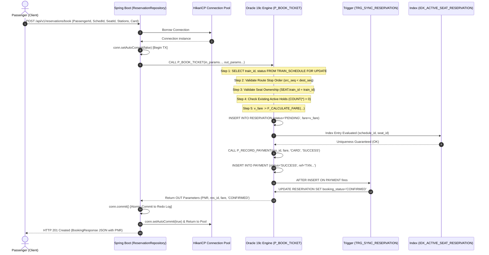

# System Architecture & Component Interactions

**Course Code:** BCSE302L — Database Management Systems  
**Project Title:** Terminus: High-Integrity Railway Reservation & Inventory Management System  
**Document Ref:** `docs/SYSTEM_ARCHITECTURE.md`  

---

## 1. Architectural Philosophy & Overview

The **Terminus Railway Reservation System** is architected as an enterprise-grade, three-tier software application. In accordance with principles taught in **BCSE302L**, the architecture purposefully avoids heavy Object-Relational Mapping (ORM) frameworks like Hibernate/JPA. Instead, it utilizes **direct, deterministic Java Database Connectivity (JDBC)** coupled with an active **Oracle Database 19c relational engine**.

This architectural strategy delivers four critical advantages:
1. **Zero ORM Obfuscation:** Every SQL statement, parameter binding, row lock (`FOR UPDATE`), and transaction boundary (`commit`/`rollback`) is explicitly declared in Java and PL/SQL code.
2. **Database Engine Compute Offloading:** Complex multi-table aggregations, dynamic fare mathematics, route sequence verifications, and payment reconciliation are computed natively within the Oracle kernel, eliminating network latency and eliminating the N+1 select problem.
3. **Pessimistic Concurrency at the Engine Core:** Concurrency control is enforced at the database row level rather than in distributed application memory caches, ensuring 100% ACID adherence across concurrent application instances.
4. **Clean Decoupling:** The Presentation, Application, and Database tiers interact via well-defined contract boundaries (RESTful JSON APIs and Oracle Thin JDBC protocols).

---

## 2. Three-Tier Architecture Blueprint

```mermaid
flowchart TB
    subgraph Tier1 ["Tier 1: Presentation Tier (Client)"]
        UI_Search["Train Search & Schedule Browser"]
        UI_Seats["Interactive Visual Seat Layout"]
        UI_Booking["Passenger Booking & Payment Terminal"]
        UI_PNR["PNR Status & Cancellation Console"]
        UI_Admin["Fleet & Infrastructure Admin Dashboard"]
        UI_Lab["Database Operations Lab & SQL Profiler"]
    end

    subgraph Tier2 ["Tier 2: Application Tier (Spring Boot / Java 21)"]
        REST_Layer["REST Controllers\n(ReservationController, TrainController, LabController)"]
        Service_Layer["Service Layer\n(ReservationService, TrainService, AdminService)"]
        JDBC_Layer["Native JDBC Repositories\n(ReservationRepository, SeatRepository, ReportRepository)"]
        HikariPool["HikariCP Connection Pool\n(Min: 2, Max: 10 Conns)"]
    end

    subgraph Tier3 ["Tier 3: Database Tier (Oracle 19c Enterprise)"]
        Oracle_Net["Oracle Listener (Port 1521)"]
        Schema_Tables["8 Normalized Relational Tables\n(PASSENGER, STATION, TRAIN, TRAIN_STOP,\nTRAIN_SCHEDULE, SEAT, RESERVATION, PAYMENT)"]
        PLSQL_Engine["PL/SQL Procedural Engine\n(P_BOOK_TICKET, P_RECORD_PAYMENT,\nP_CANCEL_RESERVATION, P_EXPIRE_STALE_RESERVATIONS)"]
        Functions_Triggers["Stored Functions & ECA Triggers\n(F_CALCULATE_FARE, F_AVAILABLE_SEAT_COUNT,\nTRG_VALIDATE_RESERVATION, TRG_SYNC_RESERVATION_ON_PAYMENT)"]
        Index_Engine["Physical Indexes & Deduplication\n(B-Tree Indexes + Function-Based IDX_ACTIVE_SEAT_RESERVATION)"]
    end

    Tier1 -->|HTTP / JSON (Port 8080 / 5173)| REST_Layer
    REST_Layer --> Service_Layer
    Service_Layer --> JDBC_Layer
    JDBC_Layer --> HikariPool
    HikariPool -->|OJDBC11 Thin Protocol TCP/IP| Oracle_Net
    Oracle_Net --> Schema_Tables
    Oracle_Net --> PLSQL_Engine
    PLSQL_Engine --> Functions_Triggers
    PLSQL_Engine --> Index_Engine
    Functions_Triggers --> Schema_Tables
    Index_Engine --> Schema_Tables
```

---

## 3. Tier-by-Tier Component Specifications

### 3.1 Tier 1: Presentation Tier (Client UI)
- **Technology:** React 18, TypeScript / Modern ES6, Vite build tool, Tailwind CSS styling, Lucide icons.
- **Responsibilities:**
  - Rendering responsive user interfaces for station search, train timetable inspection, and interactive berth maps.
  - Submitting asynchronous REST requests via Axios to backend endpoints.
  - Intercepting and presenting domain error notifications (e.g., seat already reserved, invalid route sequence, card declined).
  - Providing the **Database Operations Lab UI**, allowing live execution of SQL queries (Q01-Q18) and visual inspection of result grids and execution durations.

### 3.2 Tier 2: Application Tier (Spring Boot / Java 21 Core)
- **Technology:** Java 21 LTS, Spring Boot 3.2+, Spring Web, Spring JDBC (`JdbcTemplate`, `DataSource`), HikariCP Connection Pool, Slf4j / Logback logging.
- **Responsibilities:**
  - **REST Controllers:** Expose versioned REST endpoints (`/api/v1/reservations`, `/api/v1/trains`, `/api/v1/lab`, `/api/v1/reports`), handle HTTP request serialization, and map Java exceptions to standard HTTP response entities.
  - **Service Layer:** Coordinate business flows, validate client inputs, construct domain DTOs, and pass parameters to repositories.
  - **JDBC Repository Layer:** Execute parameter-bound SQL statements via `PreparedStatement` and stored procedures via `CallableStatement`.
  - **Explicit Transaction Management:** Manage database connection auto-commit states manually:
    ```java
    conn.setAutoCommit(false);
    // execute database operations...
    conn.commit(); // or conn.rollback() on exception
    ```
  - **Connection Pooling:** Maintain a persistent pool of 10 optimized physical connections to Oracle using HikariCP, eliminating connection creation overhead.

### 3.3 Tier 3: Database Tier (Oracle 19c Enterprise)
- **Technology:** Oracle Database 19c / Oracle Database Express Edition (XE 21c), Oracle PL/SQL, Advanced Relational Constraints, B-Tree Indexes, Function-Based Indexes.
- **Responsibilities:**
  - **Persistent Relational Storage:** Store and maintain the 8 core tables with full declarative referential integrity.
  - **Active Business Rule Enforcement:** Enforce route direction constraints ($Seq_{src} < Seq_{dest}$) via `TRG_VALIDATE_RESERVATION` and update reservation confirmation via `TRG_SYNC_RESERVATION_ON_PAYMENT`.
  - **High-Performance Transaction Engine:** Execute `P_BOOK_TICKET` and `P_CANCEL_RESERVATION` natively with row-level pessimistic locks (`FOR UPDATE`).
  - **Physical Double-Booking Prevention:** Enforce physical uniqueness on `(schedule_id, seat_id)` exclusively for `PENDING` and `CONFIRMED` bookings via `IDX_ACTIVE_SEAT_RESERVATION`.
  - **Auditing & Analytical Processing:** Provide aggregated views and window function analytics for management reporting.

---

## 4. End-to-End Transactional Data Flows

### 4.1 End-to-End Ticket Booking Workflow

The diagram below illustrates the exact sequence of events, locking protocols, and transaction boundaries during a passenger ticket booking:



### 4.2 Ticket Cancellation and Automatic Refund Data Flow
1. **Client Request:** Passenger submits PNR cancellation request (`POST /api/v1/reservations/cancel`).
2. **Procedure Call:** Backend opens a transaction and invokes `CallableStatement` on `P_CANCEL_RESERVATION(p_pnr, ...)`.
3. **Pessimistic Row Lock:** Oracle locates the reservation record by PNR and acquires an exclusive row lock using `FOR UPDATE`.
4. **Net Payment Computation:** Oracle executes `F_NET_PAID_AMOUNT(v_res_id)` to calculate total previous payments minus previous refunds.
5. **Status Update:** Oracle updates `RESERVATION.booking_status = 'CANCELLED'`.
6. **Sparse Index De-Registration:** Because the booking status is now `'CANCELLED'`, the expression in `IDX_ACTIVE_SEAT_RESERVATION` evaluates to `(NULL, NULL)`. The seat immediately becomes available for re-booking by other sessions.
7. **Refund Insertion:** If net captured funds $> 0$, Oracle calls `P_RECORD_PAYMENT` with `payment_method = 'REFUND'` and `payment_status = 'REFUND_SUCCESS'`.
8. **Explicit Commit:** The backend verifies successful completion and issues `conn.commit()`, persisting both cancellation and refund atomically.

### 4.3 Database Operations Lab Analytical Query Flow
1. **Lab Request:** Instructor or student selects Query `Q05` (Top 5 Busiest Routes) from the Operations Lab UI.
2. **REST Invocation:** Client sends `GET /api/v1/admin/queries/Q05`.
3. **PreparedStatement Execution:** `AdminRepository` prepares the pre-registered SQL query text, binds optional threshold arguments, and starts a microsecond timer.
4. **Execution & Metadata Extraction:** `PreparedStatement.executeQuery()` retrieves the `ResultSet`. Using `ResultSetMetaData`, the backend dynamically extracts column names, types, and values into a `List<Map<String, Object>>`.
5. **Profiling Response:** Backend returns the query dataset, row count, and exact execution duration (ms) to the UI for visual presentation.

---

## 5. Component Interaction & Communication Protocols

| Interface Boundary | Source Component | Destination Component | Protocol / Transport | Data Payload Format |
| :--- | :--- | :--- | :--- | :--- |
| **Client $\leftrightarrow$ Server** | React 18 Frontend | Spring Boot REST API | HTTP 1.1 / JSON over TLS/TCP | JSON DTOs (`BookingRequest`, `ApiResponse<T>`) |
| **Server $\leftrightarrow$ Database** | Spring Boot JDBC Layer | Oracle 19c Enterprise | Oracle Net Thin Protocol (TCP/IP 1521) | Native Oracle Wire Protocol (TTC / Two-Task Common) |
| **Database Internal** | Procedural Engine | Relational Tables & Storage | Direct Memory / SGA Buffer Cache | Oracle Internal Block Format / Redo Buffers |
| **Database Internal** | Triggers / Functions | Stored Procedures | In-Kernel PL/SQL Call Stack | Native C/PLSQL Shared Memory |
