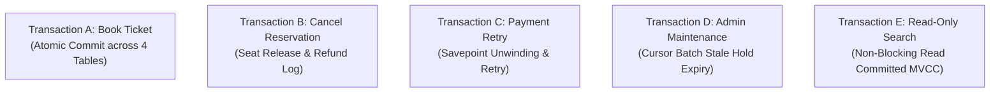

# Transaction Management & ACID Workflows

**Course Code:** BCSE302L — Database Management Systems  
**Project Title:** Terminus: High-Integrity Railway Reservation & Inventory Management System  
**Document Ref:** `docs/TRANSACTION_MANAGEMENT.md`  

---

## 1. Transactional Architecture Overview

In **Terminus**, every operational action is partitioned into explicit, discrete transactional units designed to preserve database consistency, prevent phantom reads, and eliminate dirty writes. 

Transactions are managed across five distinct workflows (**Transactions A through E**), covering passenger reservations, cancellations, payment retries, batch administrative maintenance, and read-only searches.



---

## 2. In-Depth Documentation of Transactions A through E

---

### Transaction A: End-to-End Atomic Ticket Booking Workflow
- **Business Goal:** Atomically allocate an available seat, record passenger reservation coordinates, process payment settlement, and confirm the booking.
- **Tables Involved:** `TRAIN_SCHEDULE`, `TRAIN_STOP`, `SEAT`, `PASSENGER`, `RESERVATION`, `PAYMENT`.
- **Isolation Level:** Oracle Read Committed with Pessimistic Row Locking (`FOR UPDATE`).
- **Sequential Transaction Steps:**
  1. `conn.setAutoCommit(false)`: Disables automatic commits on the JDBC connection.
  2. `SELECT train_id, schedule_status FROM TRAIN_SCHEDULE WHERE schedule_id = ? FOR UPDATE`: Acquires an exclusive row-level lock on the trip schedule.
  3. Validates that the passenger exists, the travel class exists on the train, and boarding stop sequence precedes deboarding stop sequence ($Seq_{src} < Seq_{dest}$).
  4. Queries `RESERVATION` to ensure that the target seat has zero active (`PENDING` or `CONFIRMED`) bookings on this schedule.
  5. Computes dynamic fare via `F_CALCULATE_FARE`.
  6. Inserts a new record into `RESERVATION` with `booking_status = 'PENDING'`.
  7. Invokes `P_RECORD_PAYMENT` with `payment_status = 'SUCCESS'`.
  8. Database trigger `TRG_SYNC_RESERVATION_ON_PAYMENT` fires synchronously in-flight, updating `RESERVATION.booking_status` to `'CONFIRMED'`.
  9. `conn.commit()`: Flushes the multi-table operation atomically to Oracle redo logs.
  10. **Failure Rollback Path:** If any step raises an error (e.g., seat already reserved, payment gateway decline), the catch block executes `conn.rollback()`, ensuring zero residual records.

#### JDBC Implementation Pattern:
```java
Connection conn = null;
try {
    conn = dataSource.getConnection();
    conn.setAutoCommit(false); // Begin Transaction A

    String callSql = "{CALL P_BOOK_TICKET(?, ?, ?, ?, ?, ?, ?, ?, ?, ?, ?)}";
    try (CallableStatement cs = conn.prepareCall(callSql)) {
        cs.setLong(1, passengerId);
        cs.setLong(2, scheduleId);
        cs.setLong(3, srcStationId);
        cs.setLong(4, destStationId);
        cs.setLong(5, seatId);
        cs.setString(6, "CARD");
        cs.setString(7, "SUCCESS");

        cs.registerOutParameter(8, Types.NUMERIC);
        cs.registerOutParameter(9, Types.VARCHAR);
        cs.registerOutParameter(10, Types.NUMERIC);
        cs.registerOutParameter(11, Types.VARCHAR);

        cs.execute();

        // Commit persists schedule state, reservation, and payment atomically
        conn.commit();
        log.info("Transaction A Committed successfully. PNR={}", cs.getString(9));
    }
} catch (SQLException e) {
    if (conn != null) {
        conn.rollback(); // Rollback wipes intermediate state
        log.warn("Transaction A rolled back due to error: {}", e.getMessage());
    }
    throw new DatabaseOperationException(e.getMessage(), e);
} finally {
    if (conn != null) { conn.setAutoCommit(true); conn.close(); }
}
```

---

### Transaction B: Reservation Cancellation with Automatic Refund
- **Business Goal:** Cancel a confirmed booking, transition its state to release the seat hold, and disburse a full financial refund.
- **Tables Involved:** `RESERVATION`, `PAYMENT`, `SEAT`.
- **Sequential Transaction Steps:**
  1. `conn.setAutoCommit(false)`: Enters transaction boundary.
  2. `SELECT reservation_id, booking_status FROM RESERVATION WHERE pnr = ? FOR UPDATE`: Locks the specific reservation row.
  3. Validates that current status is `'CONFIRMED'` or `'PENDING'` (rejects if already `'CANCELLED'`).
  4. Computes refundable balance using `F_NET_PAID_AMOUNT(v_res_id)`.
  5. Updates `RESERVATION.booking_status = 'CANCELLED'`.
  6. Sparse unique index `IDX_ACTIVE_SEAT_RESERVATION` detects status change; the index tuple evaluates to `NULL`, immediately freeing the seat for other users.
  7. If net balance $> 0$, calls `P_RECORD_PAYMENT` with `payment_method = 'REFUND'` and `payment_status = 'REFUND_SUCCESS'`.
  8. `conn.commit()`: Commits both cancellation and refund atomically.

#### JDBC Implementation Pattern:
```java
Connection conn = null;
try {
    conn = dataSource.getConnection();
    conn.setAutoCommit(false); // Begin Transaction B

    String callSql = "{CALL P_CANCEL_RESERVATION(?, ?, ?, ?)}";
    try (CallableStatement cs = conn.prepareCall(callSql)) {
        cs.setString(1, pnr);
        cs.registerOutParameter(2, Types.VARCHAR); // p_result
        cs.registerOutParameter(3, Types.VARCHAR); // p_booking_status
        cs.registerOutParameter(4, Types.NUMERIC); // p_refund_amount

        cs.execute();
        conn.commit(); // Atomic commit of cancellation & refund
        log.info("Transaction B Committed. Refund issued: INR {}", cs.getBigDecimal(4));
    }
} catch (SQLException e) {
    if (conn != null) conn.rollback();
    throw new DatabaseOperationException("Cancellation transaction failed: " + e.getMessage(), e);
} finally {
    if (conn != null) { conn.setAutoCommit(true); conn.close(); }
}
```

---

### Transaction C: Payment Failure & Savepoint Retry Workflow
- **Business Goal:** Handle payment gateway declines without aborting the customer booking session, utilizing `SAVEPOINT` to unwind declined payment records while preserving the booking hold.
- **Tables Involved:** `RESERVATION`, `PAYMENT`.
- **Sequential Transaction Steps:**
  1. System creates a `PENDING` reservation hold.
  2. Application establishes named savepoint: `conn.setSavepoint("BeforePayment")`.
  3. Attempt 1: Initiates payment with method `CARD`. Gateway returns `FAILED`.
  4. System executes `P_RECORD_PAYMENT(res_id, fare, 'CARD', 'FAILED')`.
  5. Reservation remains in `PENDING` status.
  6. User selects alternative payment channel `UPI`.
  7. Application rolls back to savepoint: `conn.rollback(sp)` (or inserts second retry payment row).
  8. Attempt 2: Executes `P_RECORD_PAYMENT(res_id, fare, 'UPI', 'SUCCESS')`.
  9. Trigger `TRG_SYNC_RESERVATION_ON_PAYMENT` confirms reservation.
  10. `conn.commit()`: Persists final successful payment state.

#### JDBC Implementation Pattern:
```java
Connection conn = null;
Savepoint sp = null;
try {
    conn = dataSource.getConnection();
    conn.setAutoCommit(false); // Begin Transaction C

    // Insert pending reservation...
    sp = conn.setSavepoint("BeforePaymentAttempt");

    try {
        // Attempt 1: Risky gateway transaction
        recordPayment(conn, reservationId, fare, "CARD", simulatedStatus);
    } catch (PaymentFailedException pfe) {
        // Revert failed payment attempt to savepoint
        conn.rollback(sp);
        log.warn("Payment attempt 1 failed. Unwound to savepoint. Retrying with UPI...");

        // Attempt 2: Alternate channel
        recordPayment(conn, reservationId, fare, "UPI", "SUCCESS");
    }

    conn.commit(); // Final commit
} catch (SQLException e) {
    if (conn != null) conn.rollback();
    throw new DatabaseOperationException(e.getMessage(), e);
} finally {
    if (conn != null) { conn.setAutoCommit(true); conn.close(); }
}
```

---

### Transaction D: Admin Maintenance & Batch Hold Expiration
- **Business Goal:** Sweep abandoned `PENDING` reservation holds that exceed retention limits (e.g., 15 minutes) and transition them to `EXPIRED` to restore seat availability.
- **Tables Involved:** `RESERVATION`.
- **Sequential Transaction Steps:**
  1. `conn.setAutoCommit(false)`: Opens maintenance transaction.
  2. Declares explicit cursor `CURSOR c_stale IS SELECT ... FOR UPDATE` selecting expired reservations.
  3. Iterates through records, updating each via `UPDATE RESERVATION SET booking_status = 'EXPIRED' WHERE CURRENT OF c_stale`.
  4. Sparse index `IDX_ACTIVE_SEAT_RESERVATION` automatically invalidates held seats upon update.
  5. `conn.commit()`: Persists the entire batch update and releases all cursor locks simultaneously.

#### JDBC Implementation Pattern:
```java
Connection conn = null;
try {
    conn = dataSource.getConnection();
    conn.setAutoCommit(false); // Begin Transaction D

    String sql = "{CALL P_EXPIRE_STALE_RESERVATIONS(?, ?)}";
    try (CallableStatement cs = conn.prepareCall(sql)) {
        cs.setInt(1, 15); // Expire holds older than 15 minutes
        cs.registerOutParameter(2, Types.INTEGER);

        cs.execute();
        int expiredCount = cs.getInt(2);

        conn.commit(); // Atomic commit of batch sweep
        log.info("Transaction D Committed: {} stale holds expired.", expiredCount);
    }
} catch (SQLException e) {
    if (conn != null) conn.rollback();
    throw new DatabaseOperationException(e.getMessage(), e);
} finally {
    if (conn != null) { conn.setAutoCommit(true); conn.close(); }
}
```

---

### Transaction E: Read-Only High-Throughput Search
- **Business Goal:** Execute complex station-to-station train schedule and seat availability inquiries without acquiring intrusive row locks or blocking concurrent booking operations.
- **Tables Involved:** `TRAIN`, `TRAIN_SCHEDULE`, `TRAIN_STOP`, `STATION`, `SEAT`, `RESERVATION`.
- **Concurrency Mode:** Pure Read Committed Multi-Version Concurrency Control (MVCC).
- **Sequential Transaction Steps:**
  1. Connection is set to read-only mode: `conn.setReadOnly(true)`.
  2. System issues complex multi-table query (Q01).
  3. Oracle reconstructs point-in-time consistent view from undo segments without locking any rows.
  4. Readers never block writers, and writers never block readers.
  5. `conn.close()`: Connection returned cleanly to the pool.

#### JDBC Implementation Pattern:
```java
try (Connection conn = dataSource.getConnection()) {
    conn.setReadOnly(true); // Optimize connection for read-only throughput

    String sql = "... (Query Q01) ...";
    try (PreparedStatement ps = conn.prepareStatement(sql)) {
        ps.setLong(1, srcStationId);
        ps.setLong(2, destStationId);
        ps.setDate(3, java.sql.Date.valueOf(journeyDate));

        try (ResultSet rs = ps.executeQuery()) {
            // Process non-locking consistent snapshot...
        }
    }
}
```

---

## 3. Transaction Characteristics Matrix

| Workflow | Type | Mutating Tables | Locks Held | Commit Mechanism | Rollback Strategy |
| :--- | :--- | :--- | :--- | :--- | :--- |
| **Transaction A** | OLTP Write | `TRAIN_SCHEDULE`, `RESERVATION`, `PAYMENT` | Exclusive row lock on `TRAIN_SCHEDULE` and `RESERVATION` | Explicit `conn.commit()` | Full `conn.rollback()` on error |
| **Transaction B** | OLTP Write | `RESERVATION`, `PAYMENT` | Exclusive row lock on target `RESERVATION` | Explicit `conn.commit()` | Full `conn.rollback()` on error |
| **Transaction C** | OLTP Write | `RESERVATION`, `PAYMENT` | Exclusive row lock on `RESERVATION` | Explicit `conn.commit()` | `conn.rollback(savepoint)` on retry |
| **Transaction D** | Batch Maint | `RESERVATION` | Row-level locks via `c_stale FOR UPDATE` | Explicit `conn.commit()` after loop | Full `conn.rollback()` on cursor error |
| **Transaction E** | OLAP Read | None (Read-only) | **Zero locks** (MVCC consistent read) | None required | None required |
