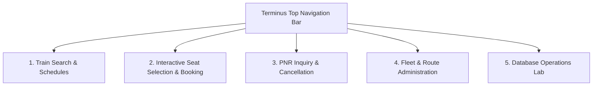
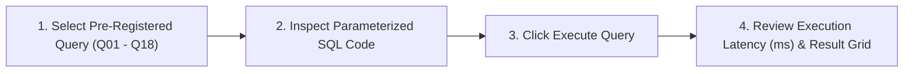

# User & Administrator Operational Guide

**Course Code:** BCSE302L — Database Management Systems  
**Project Title:** Terminus: High-Integrity Railway Reservation & Inventory Management System  
**Document Ref:** `docs/USER_GUIDE.md`  

---

## 1. System Navigation & User Interface Blueprint

The **Terminus Railway Reservation System** provides an intuitive, responsive web application for passengers, railway operational clerks, and administrative auditors. 

The application layout is structured into five primary navigation modules:

---

## 2. Operational Workflows & Step-by-Step Guides

---

### 2.1 How to Search for Available Trains Between Stations
1. Navigate to the **Train Search** tab from the top navigation bar.
2. In the **Origin Station** dropdown, select your departure station (e.g., `New Delhi [NDLS]`).
3. In the **Destination Station** dropdown, select your target station (e.g., `Lucknow [LKO]`).
4. Select your intended **Journey Date** from the calendar picker.
5. Click the primary **Find Trains** button.
6. The system issues an asynchronous request executing **Query Q01**, returning all active trains servicing that pair of stations where origin stop sequence precedes destination stop sequence.
7. Each search result card displays:
   - Train Number and Commercial Name (e.g., `12004 Lucknow Shatabdi Express`).
   - Scheduled Departure and Terminus Arrival times.
   - Total rail distance in kilometers.
   - Real-time remaining seat capacity computed by `F_AVAILABLE_SEAT_COUNT`.

> **[Screenshot Placeholder: Train Search Screen]**  
> *Description: Search interface showing origin and destination station dropdowns, travel date picker, and result cards listing the Lucknow Shatabdi and Gomti Express with green badges indicating available seat counts.*

---

### 2.2 How to Select Berths and Book a Ticket
1. From the train search results card, click **Select Seats & Book**.
2. The **Interactive Visual Seat Layout** modal opens, displaying the train's coaches (e.g., `A1`, `B1`, `S1`):
   - **Green Berths:** Available for booking.
   - **Red Berths:** Already reserved in `CONFIRMED` or `PENDING` status.
3. Click on any green seat to select your preferred coach and berth position (e.g., `Coach B1, Seat 5, Lower Berth, Class 3A`).
4. In the booking drawer on the right side:
   - Select or enter the **Passenger Profile** (Name, Age, Gender, Mobile Phone, Email).
   - Review the dynamically computed ticket fare calculated by `F_CALCULATE_FARE`.
   - Select your payment channel: `CARD`, `UPI`, `NET_BANKING`, or `CASH`.
5. Click **Confirm & Pay Now**.
6. The backend executes `P_BOOK_TICKET` inside an atomic transaction. Upon completion, a confirmation card appears displaying your **Unique 10-digit PNR** (e.g., `PNR1000000015`), booking timestamp, and confirmed seat allocation.

> **[Screenshot Placeholder: Interactive Seat Layout Modal]**  
> *Description: Coach layout grid depicting rows of Lower, Middle, Upper, and Side berths. Coach B1 is active with seat 5 highlighted in blue with a checkmark, and occupied seats grayed out.*

---

### 2.3 How to Check PNR Status & Journey Itineraries
1. Click on the **PNR Status** tab in the navigation bar.
2. Enter your 10-12 character PNR code in the search field (e.g., `PNR1000000001`).
3. Click **Track Reservation**.
4. The system executes a parameterized join query (Query Q03) retrieving:
   - Passenger Name and Demographic Category.
   - Train Number, Train Name, and Travel Date.
   - Boarding Station and Deboarding Station.
   - Assigned Coach Number, Seat Number, Class, and Berth Type.
   - Real-Time Booking Status badge (`CONFIRMED`, `PENDING`, `CANCELLED`, or `EXPIRED`).
   - Financial Ledger summary showing Gross Fare and Net Paid amount.

> **[Screenshot Placeholder: PNR Inquiry Itinerary Card]**  
> *Description: Modern passenger boarding pass display showing PNR1000000001, Rahul Sharma, Mumbai Central to New Delhi, Coach A1, Seat 1, First AC (1A), with a bright green CONFIRMED status pill.*

---

### 2.4 How to Cancel a Reservation & Receive Automatic Refunds
1. In the **PNR Status** view, locate your confirmed reservation.
2. If the ticket is in `CONFIRMED` or `PENDING` status, a red **Cancel Ticket** button is displayed at the bottom of the itinerary card.
3. Click **Cancel Ticket**.
4. A confirmation dialog appears detailing:
   - Original fare paid.
   - Eligible refund amount calculated by `F_NET_PAID_AMOUNT`.
5. Click **Confirm Cancellation**.
6. Stored procedure `P_CANCEL_RESERVATION` executes:
   - Status updates to `CANCELLED`.
   - Allocated seat is instantly freed in the database unique index.
   - An automated refund record (`REFUND_SUCCESS`) is inserted into the payment ledger.
7. The status badge immediately updates to `CANCELLED` and displays the refund transaction reference code.

> **[Screenshot Placeholder: Cancellation Confirmation Dialog]**  
> *Description: Modal prompting confirmation with a summary of the ticket being cancelled and displaying "Refund Amount: INR 4152.00 will be credited to original payment method".*

---

### 2.5 How to View Payment Transaction History
1. In the PNR details view, expand the **Payment & Settlement Ledger** accordion.
2. The ledger displays all financial transactions associated with this reservation:
   - Primary payment record with Amount, Channel (`UPI`/`CARD`), Status (`SUCCESS`), and Bank Reference (`TXN...`).
   - If cancelled, an offsetting refund record showing Method `REFUND` and Status `REFUND_SUCCESS`.
   - Net captured balance equals ₹0.00 after full cancellation.

---

### 2.6 How to Use the Fleet Administration Dashboard
1. Click the **Admin Dashboard** tab.
2. The administrative console provides fleet operational controls:
   - **Station Management:** Add new stations, update city/state jurisdictions, and view serviced train counts.
   - **Train & Route Dispatcher:** View active train services, inspect stop sequences and cumulative distances, and activate or deactivate train rakes.
   - **Schedule Dispatcher:** Generate new calendar departure runs, assign departure timestamps, and transition schedule statuses (`SCHEDULED` $\rightarrow$ `RUNNING` $\rightarrow$ `COMPLETED`).
   - **Stale Reservation Expiry Tool:** Click **Run Maintenance Sweep** to trigger `P_EXPIRE_STALE_RESERVATIONS`, sweeping unconfirmed booking holds older than 15 minutes and freeing seats.

> **[Screenshot Placeholder: Admin Dashboard Overview]**  
> *Description: Executive admin grid with cards showing Total Active Trains (4), Stations (10), Today's Departures (8), Total Daily Revenue, and an active maintenance button.*

---

### 2.7 How to Use the Database Operations Lab & SQL Profiler
The **Database Operations Lab** is a dedicated environment designed specifically for faculty evaluation, DBMS experimentation, and SQL query profiling.

#### Step-by-Step Lab Execution:
1. Navigate to the **Database Lab** tab.
2. In the query selector sidebar, select any of the 18 pre-registered analytical queries:
   - `Q01: Train Search Between Stations`
   - `Q04: Station Footfall & Daily Revenue`
   - `Q05: Top 5 Busiest Corridors`
   - `Q08: Passenger Loyalty Classification`
   - `Q10: Refund Reconciliation Ledger`
   - `Q14: Double-Booking Integrity Audit`
   - `Q18: Schedule Coach & Berth Seat Map`
3. The SQL editor panel renders the exact Oracle SQL statement with parameter placeholders.
4. Supply optional query parameters in the input fields (or accept default values).
5. Click the green **Execute Query** button.
6. The backend executes the query via `PreparedStatement` and returns:
   - **Execution Latency:** Measured in milliseconds (typically 2ms to 25ms).
   - **Rows Returned:** Total records fetched.
   - **Interactive Result Table:** Formatted tabular view with sortable columns.
7. Click **Inspect Schema** to view live table column types, nullable flags, primary keys, and index configurations directly from Oracle's data dictionary (`USER_TAB_COLUMNS`, `USER_CONSTRAINTS`).

> **[Screenshot Placeholder: Database Operations Lab View]**  
> *Description: Operations Lab UI with Query Q05 selected. The SQL editor displays the analytic window function query, and below it, an execution metrics pill reads "Execution Time: 12ms | Rows: 3" above a neat data table.*
